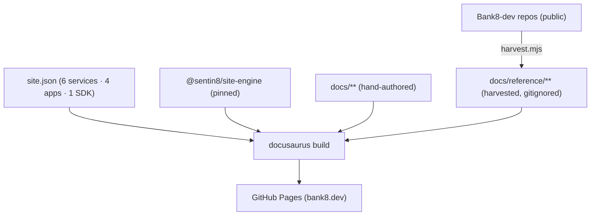

# Bank8:Site - bank8.dev
[](../LICENSE)
[](https://www.rust-lang.org/)
[](https://bank8.dev/docs/services/site)
[](https://bank8.dev/docs/products/bank8-site)

> The Bank8 public website at [bank8.dev](https://bank8.dev): every
> product, app, and SDK of the finance vertical, with its banking
> invariants and inherited security posture front and center. Built on
> `@sentin8/site-engine` (Docusaurus v3). Program design of record:
> `design/sentin8-websites-design.md` (WEB §4.5).

## 1. Summary

bank8.dev is the finance vertical's product site: a landing page
detailing all six services (ledger, payments, fdx, reporting, risk,
compliance), three apps (ebank, eteller, admin; the recipient app
eOpenCA lives on openfin8.dev), and the bank8
SDK; per-product pages with use cases in detail and API surface tables;
the vertical's security invariants; developer lifecycle; samples; and a
**Reference** section harvested at build time from each unit repo's own
docs trio - the repositories stay the source of truth.

## 2. Motivation

Bank8's six services carry 300+ endpoints of maintainer-grade docs, but
nothing explains to a bank's evaluation team *what the vertical does for
them*: the double-entry guarantees, consent-checked open banking, the
detection/filing separation, and the cross-vertical story (hotel8 and
bill8 both delegate payments here). This site is that layer - with
architecture deep-dives harvested so marketing can never drift from
the code.

## 3. Architecture



## 4. Content map

| Route | Content |
|---|---|
| `/` | Hero · product cards (6) · apps (4) · SDK · invariants strip · platform & cross-vertical showcase |
| `/docs/` | Vertical overview (architecture diagram, product table) |
| `/docs/products/{unit}` | Per product: use cases in detail · API table · invariants |
| `/docs/apps/{app}` | Per app: purpose, what it demonstrates |
| `/docs/sdk/` | The bank8 facade: import paths, conventions |
| `/docs/security/` | Vertical invariants + inherited platform pillars |
| `/docs/developers/` | Single-repo story, lifecycle, Make targets |
| `/docs/samples/` | cURL + Dart + Rust first calls |
| `/docs/reference/{unit}/` | Harvested README/DESIGN/BUSINESS per unit |

## 5. Development

```bash
npm install
npm run harvest   # renders docs/reference/ from sibling repos (offline)
npm start
npm run build     # fails on broken links
```

Adding a unit: edit `site.json` → add `docs/products/{slug}.md` → the
harvester picks up the repo trio automatically.

## 6. Deployment

Push to `main` → `ci.yml` calls `Sentin8/sentin8-ci site.yml@ci-v1` →
harvest → build → GitHub Pages. Weekly scheduled rebuild refreshes
harvested content. Custom domain (bank8.dev) via `static/CNAME`
(operator DNS step:).

---

**Architecture & Design:** Bank8:Site and its underlying concepts were designed by [Hamid Jahanzad](https://www.linkedin.com/in/hamidjahanzad/).