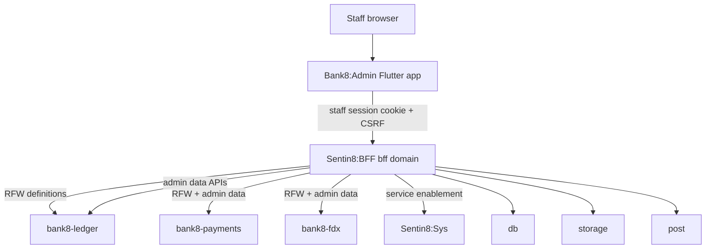
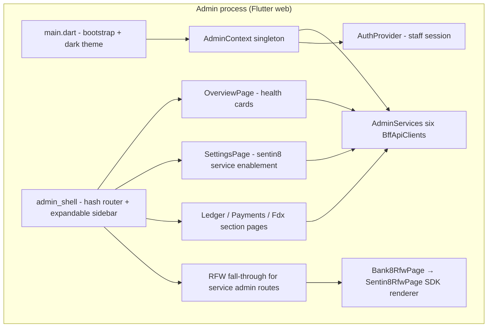
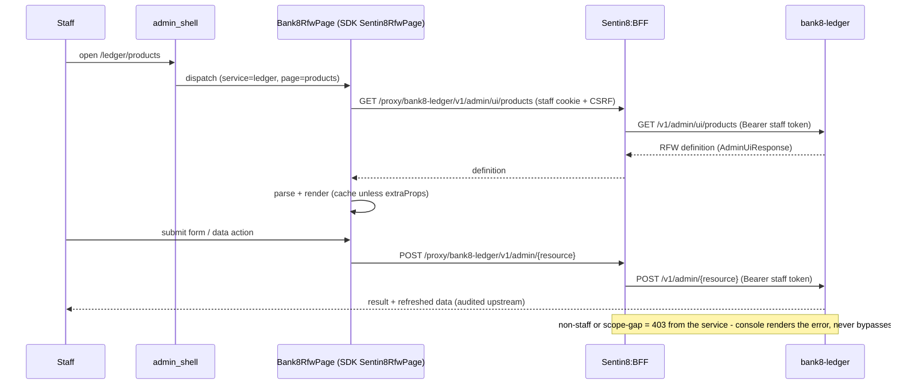
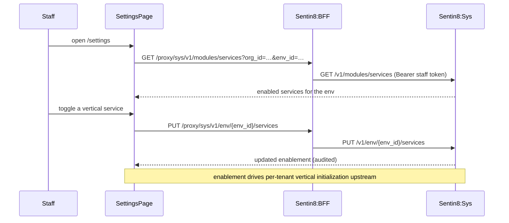
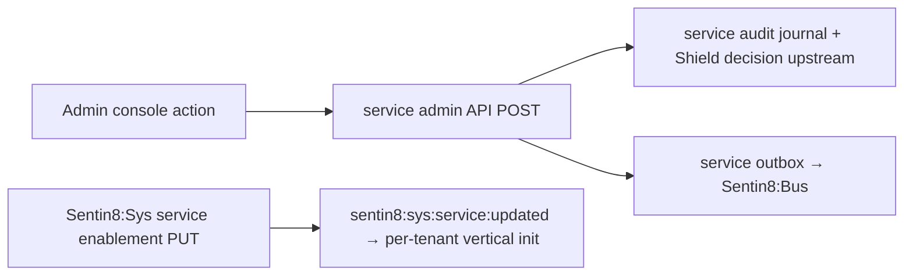
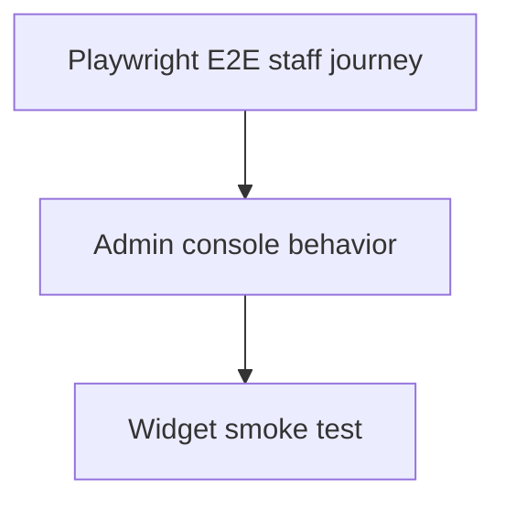

# Bank8:Admin - Detailed Design Document

Overview-level material lives in `README.md`; the business view lives in
`BUSINESS.md`.

## 1. Scope & Context

**What Admin owns:** the staff-only console presentation layer; the
`AdminContext` singleton state; the RFW rendering bridge
(`rfw/rfw_page.dart`); the hand-written section pages (ledger / payments /
fdx); the health overview and the sentin8 service-enablement settings page;
the listing manifest (`app8-listing.json`, mirrored in `app.json`).

**What Admin does NOT own (delegates):** staff identity (Sentin8:Auth);
session/token custody and scope gating (Sentin8:BFF); admin UX definitions
and their data APIs (each backend service - ledger, payments, fdx);
service enablement state (Sentin8:Sys); persistence (Sentin8:DB via BFF);
policy decisions (Shield inside each service).

## 2. Runtime Architecture

Request lifecycle (RFW-rendered admin page):

Request lifecycle (service enablement):

## 3. Data Model

Admin persists **no tables of its own** - it renders service-owned admin
state:

| Domain object | Owned by | Admin access |
|---|---|---|
| RFW admin UI definitions | each service (`GET /v1/admin/ui/{page}`) | fetch + render + submit |
| Ledger admin data (products, accounts, postings, schedules, DLQ, balances, customers, audit) | Bank8:Ledger | list/read (+ product create) via admin data APIs |
| Payments admin data (instructions, rules, cards, files, integrations, manual-decisions, mandates, templates, calendars, dashboards) | Bank8:Payments | list/read via admin data APIs |
| FDX admin data (provider profile, recipients, consents) | Bank8:FDX | read via admin data APIs |
| Service enablement | Sentin8:Sys | read + toggle per env |
| Service health | each service `/v1/health` | read |

No client-resident durable state beyond navigation; no tokens stored
client-side.

## 4. API Surface

All backend calls are BFF-proxied; the app has no listening port.

| Consumer | Method + path (via BFF) | Gate | Notes |
|---|---|---|---|
| Overview | `GET /proxy/{bank8-ledger\|bank8-payments\|bank8-fdx}/v1/health` | staff | health cards |
| Settings | `GET /proxy/sys/v1/modules/services?org_id=…&env_id=…`, `PUT /proxy/sys/v1/env/{env_id}/services` | staff | service enablement |
| RFW definitions | `GET /proxy/{service}/v1/admin/ui/{page}` | staff; service admin scopes | SDK renderer fetch |
| RFW data actions | `POST /proxy/{service}/v1/admin/{resource}` | staff; service admin scopes | forms/mutations (POST alias contract) |
| Ledger sections | `GET /v1/products`, `POST /v1/products`, `GET /v1/accounts`, `GET /v1/postings`, `GET /v1/schedules`, `GET /v1/dlq`, `GET /v1/balances`, `GET /v1/customers`, `GET /v1/audit` | staff; `bank8:ledger:*` admin scopes | hand-written section pages |
| Payments sections | `GET /v1/instructions`, `GET /v1/rules`, `GET /v1/cards`, `GET /v1/files`, `GET /v1/integrations`, `GET /v1/manual-decisions`, `GET /v1/mandates`, `GET /v1/templates`, `GET /v1/calendars`, `GET /v1/dashboards` | staff; `bank8:payments:*` admin scopes | hand-written section pages |
| FDX sections | `GET /v1/provider/profile`, `GET /v1/recipient/providers`, `GET /v1/admin/consents` | staff; `bank8:fdx:*` admin scopes | hand-written section pages |

**OAuth scope manifest** (~56 scopes): identity (`openid`, `profile`,
`email`, `offline_access`); ledger (products/accounts/postings/schedules
read+write, jobs read/admin, DLQ read/republish, balances read, audit read,
customers write); payments (instructions, payments, logics,
payment-instruments, account-links, rules + rules publish, parameters, files,
manual-decisions, admin, integrations, cores, cards, mandates,
membership-directories, templates, calendars, dashboards - each read/write);
fdx (consents, recipient, provider - read/write); platform (`db:data:read/
write`, `storage:env:read/write`). Grants `authorization_code` +
`refresh_token`; `auth_mode: staff`. The console's authority is expressed
through vertical admin scopes only - no platform-wide admin scope is carried
(or needed).

Event flow Admin participates in:

## 5. Cross-Cutting Concerns

- **Authentication.** Staff-only BFF session; the console renders 403s as
  permission errors and carries no authorization logic of its own.
- **Tenant resolution.** Fail-closed runtime-context bootstrap (own origin);
  settings pages pass explicit `org_id`/`env_id` validated upstream.
- **Authorization.** Every widget-level action is gated by the service's
  admin-scope check upstream (`bank8:ledger:products:write`,
  `bank8:payments:*`, `bank8:fdx:*`); the manifest is the union of what the
  console surfaces need.
- **Audit.** All mutations are audited by the owning service (the console
  emits nothing itself).
- **Idempotency.** Mutations ride the services' admin data APIs; retry-safe
  by service contract.
- **TLS.** All traffic `https://`.
- **UI contract.** RFW renderer supports POST; service update/delete routes
  are POST aliases - the console never issues PUT/DELETE to admin data
  resources.

## 6. Failure Modes & Recovery

- **Service down** → overview shows the failed health card; RFW section
  fails with an error frame; other services unaffected (per-service clients).
- **RFW definition unavailable** → section renders the error; hand-written
  section pages remain usable where they exist (`LedgerSectionPage` etc.).
- **Enablement toggle failure** → settings page surfaces the Sys error and
  leaves the toggle pending until confirmed.
- **Session expiry** → BFF 401; staff re-authenticates via the BFF flow.
- **Bootstrap failure** → inline error page (fail closed).

## 7. Concurrency & Performance Model

- Single Flutter web isolate; six per-service clients.
- RFW definitions cached by the SDK renderer except for parameterized pages
  (`extraProps`); data lists are page-enter fetched (no polling).
- Section pages are lightweight list+form screens; no long-lived sockets.

## 8. Invariants, Insecure-Defaults Rejected, Unsafe Rationale

- The console owns no business logic: no table names, no ledger/payment
  semantics beyond labels - definitions and data come from the services.
- Staff-only at every layer; no customer journey exists in this app.
- No token in the client; fail-closed bootstrap; no direct DB/storage/config
  access (CI guards across `lib/`).
- Adding an admin surface = service publishes RFW definition + admin scopes;
  the console requires no code change for RFW-rendered pages.
- No `unsafe` code exists in this app (pure Dart, no FFI).

## 9. Testing Strategy

| Layer | Ownership | Tooling |
|---|---|---|
| Widget smoke test | theme layer renders (the console is exercised end-to-end at E2E) | `test/widget_test.dart` |
| E2E (UI only) | staff console journey inside `e2e-ts` lifecycle (sign-in → product creation) | Playwright + Flutter semantics bridge |

Not tested here (platform scope): RFW rendering internals and admin-scope
gating (platform SDK/service suites), service enablement state machine
(Sentin8:Sys suite).

## 10. Open Questions

- Placeholder sections (reconcile, csdf, dashboards) await their services'
  RFW definitions or admin APIs.
- A cross-service workflow view (operations spanning ledger + payments) may
  need a dedicated console surface once correlated flow state is exposed.

---

**Design attribution:** bank8:admin and its underlying concepts were designed by Hamid Jahanzad <Hamid@Jahanzad.com>.

