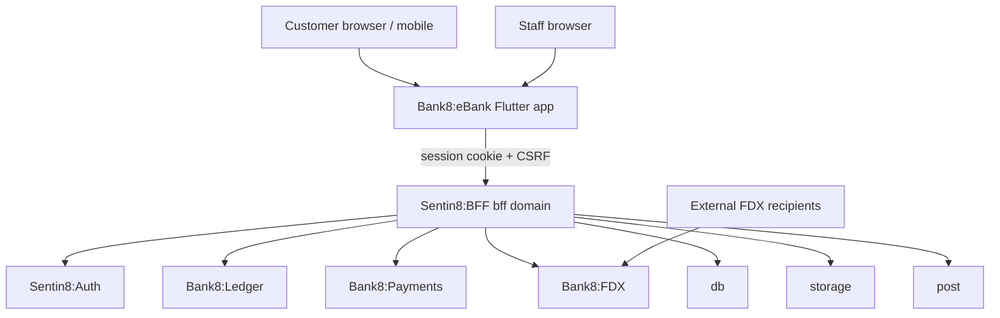
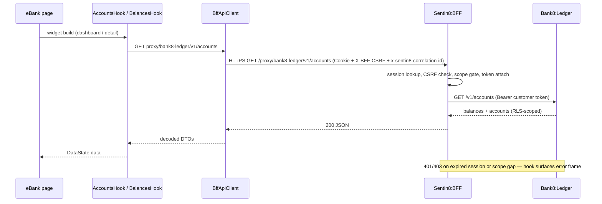
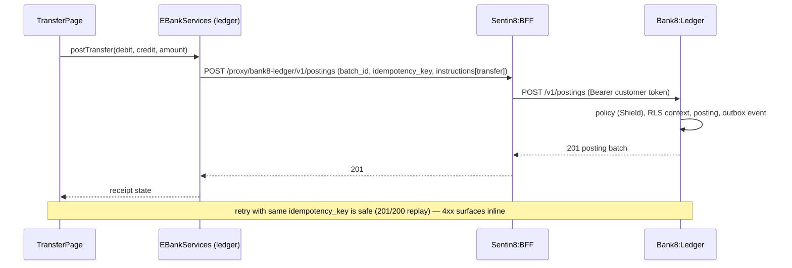
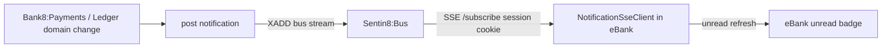
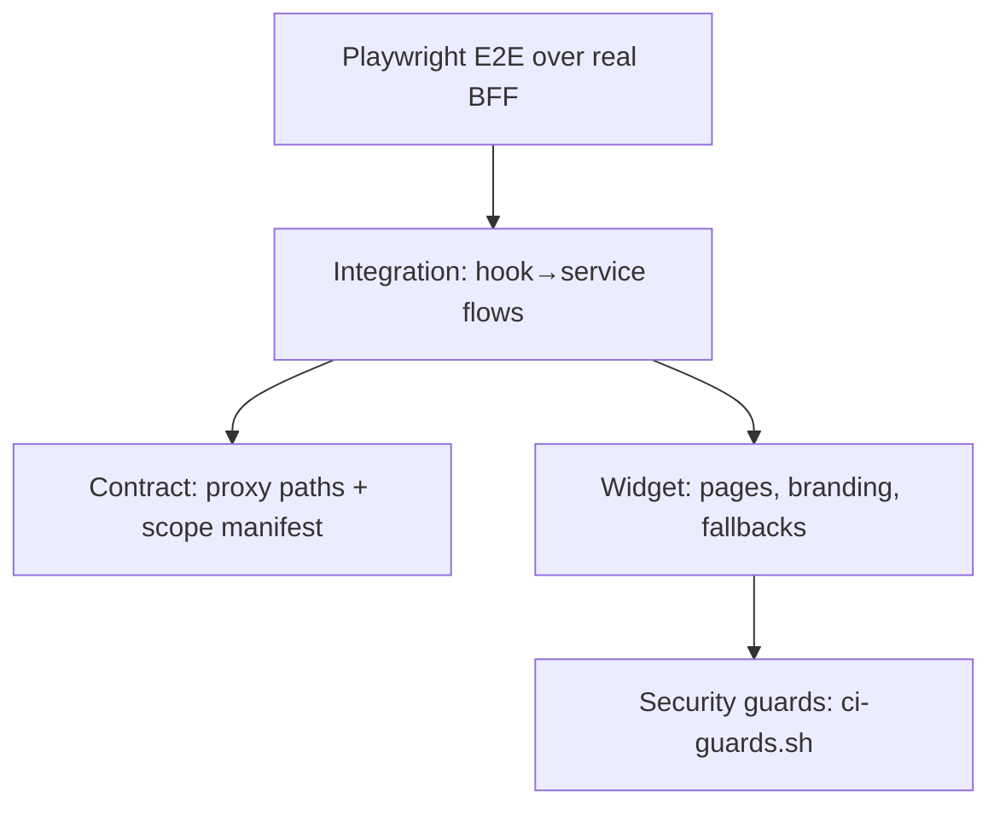

# DESIGN.md: Bank8:eBank — Detailed Design Document

Overview-level material lives in `README.md`; the business view lives in
`BUSINESS.md`. This document carries the wire-level app contract (bootstrap,
proxy surface, page routing, scope manifest) and the internal invariants.

## 1. Scope & Context

**What eBank owns:** the customer browser/mobile presentation layer; the
client-side state composition (`EBankContext`); customer journey pages
(dashboard, accounts, products, transfers, payments history, statements,
messages, FDX consents); the staff admin surface (instance overview, ledger
product activation, FDX provider administration); the app's listing manifest
(`app8-listing.json`, mirrored in `app.json`) and BFF scope whitelist
(`bff8/scope_whitelist.rs`).

**What eBank does NOT own (delegates):** identity and consent issuance
(Sentin8:Auth); financial truth (Bank8:Ledger); payment orchestration
(Bank8:Payments); the FDX provider gateway and consent enforcement
(Bank8:FDX); persistence (Sentin8:DB, via BFF); object storage (storage,
via BFF); notifications (post, via BFF); session/token custody (Sentin8:BFF);
policy decisions (Shield within each backend service).



## 2. Runtime Architecture

```mermaid
graph TD
    subgraph eBank process (Flutter web)
        MAIN[main.dart — bootstrap + theme] --> CTX[EBankContext inherited provider]
        CTX --> SVC[EBankServices six BffApiClients]
        CTX --> AUTH[AuthProvider — BFF session]
        CTX --> PROV[ensureLedgerCustomer provisioning]
        SHELL[ebank_shell — hash router + sidebar] --> PAGES[pages/*]
        SHELL --> SSE[NotificationSseClient /subscribe]
        PAGES --> HOOKS[hooks.dart + fdx_hooks.dart DataState adapters]
        HOOKS --> SVC
        PAGES --> ADMIN[pages/admin — instance / products / fdx]
        ADMIN --> SVC
    end
```

Request lifecycle (customer reads account balances):



Request lifecycle (internal transfer):



## 3. Data Model

eBank persists **no tables of its own**. It is a presentation layer over
service-owned data; the only durable state eBank participates in is
service-owned and referenced by id:

| Domain object | Owned by | eBank access |
|---|---|---|
| Customer record | Bank8:Ledger `ledger.customers` | created idempotently via `ensureLedgerCustomer` (`POST /v1/customers`, `409` tolerated) |
| Accounts, balances, postings, statements | Bank8:Ledger | read via proxy; account opening via `POST /v1/accounts` |
| Products (13 product libraries incl. current, savings, US checking/savings, Shariah savings, time deposit, loan, credit card, mortgage, LOC, wallet, BNPL, home-loan redraw) | Bank8:Ledger | read via `GET /v1/products`; admin activation/override via `POST /v1/products/{id}/versions` |
| Payments, account links (payees) | Bank8:Payments | read via `GET /v1/payments`, `GET /v1/account-links` |
| Provider profile, recipients, FDX consents | Bank8:FDX | read/revoke via `/fdx/v6/*` + `/v1/admin/recipients` |
| Statement objects | storage | signed-read URLs only (`POST /v1/storage/sign-read`) |
| Notifications | post | inbox read + mark-read (`/v1/messages*`) |

The client keeps only ephemeral UI state (form drafts, page navigation,
current route). There is no local persistence beyond the browser session.

## 4. API Surface

All backend calls are BFF-proxied (`https://{bff}/proxy/{service}/path`); the
app itself has no listening port.

| Consumer | Method + path (via BFF) | Gate | Notes |
|---|---|---|---|
| Dashboard | `GET /proxy/bank8-ledger/v1/accounts` | customer session | overview + balances |
| Account list/detail | `GET /v1/accounts`, `GET /v1/accounts/{id}`, `GET /v1/accounts/{id}/balances` | customer session | detail + balances |
| Transactions | `GET /v1/accounts/{id}/transactions?pageKey=…` | customer session | paged cursor |
| Products | `GET /v1/products` | customer session | catalog (13 products) |
| Account opening | `POST /v1/accounts` (+ idempotent `POST /v1/customers` first) | customer session; `ledger:accounts:write` | product enrollment |
| Transfer | `POST /v1/postings` (`batch_id`, `idempotency_key`, `instructions[{instruction_type: transfer, …}]`) | customer session; `ledger:postings:write` | money movement (Ledger) |
| Payments history | `GET /proxy/bank8-payments/v1/payments`, `GET /v1/account-links` | customer session | payee + payment view |
| Statements | `GET /v1/accounts/{id}/statements`, `GET /v1/accounts/statements`; `POST /proxy/storage/v1/storage/sign-read` | customer session; `storage:env:read` | signed download URLs |
| Messages | `GET /proxy/post/v1/messages?mine&unread&limit`, `GET /v1/messages/{id}`, `POST /v1/messages/{id}/read` | customer session; `post:read/write` | inbox + unread badge |
| FDX consents (customer side) | `GET /proxy/bank8-fdx/v1/fdx/v6/consents`, `PUT /fdx/v6/consents/{id}/revocation` | customer session; `fdx:provider:read/write` | review + revoke sharing |
| FDX capability | `GET /v1/fdx/v6/capability` | customer session | provider meta |
| FDX recipients (admin) | `GET /v1/admin/recipients` | staff; `bank8:fdx:admin` | registration monitoring |
| Admin products | `GET /v1/products`, `POST /v1/products/{id}/versions` | staff; `bank8:ledger:products:write` (+`accounts:write:any` onboarding assist) | activate / parameter override |
| Admin dashboard | runtime context only | staff | no backend calls |

Event flow eBank participates in (consumer side only):



## 5. Cross-Cutting Concerns

- **Authentication / token custody.** The app holds a BFF session cookie only.
  OAuth tokens are attached by the BFF server-side; no client code path ever
  serializes or logs a token. Sign-in/sign-up redirect through the BFF to the
  Sentin8:Auth hosted UI.
- **Tenant resolution.** Bootstrap reads the runtime context from the app's
  own origin (the TLS proxy injects instance identity); unknown host or
  context failure is fatal (`BootstrapErrorPage`) — never defaulted.
- **Authorization.** Pages render by role: `/admin` is staff-only (staff group
  membership + admin scopes as resolved by the BFF); customers never see
  internal accounts (holder-scoped RLS upstream makes them nonexistent).
- **Idempotency.** All mutating calls (`POST /v1/postings`, `POST /v1/accounts`,
  `POST /v1/customers`) carry idempotency keys or tolerate replay (409).
- **Correlation.** `x-sentin8-correlation-id` is generated per session and
  attached to every proxy call; the shared `AppLogger` records entries under
  the same correlation id (no metrics sink in-app).
- **Realtime posture.** Notifications are SSE (`/subscribe?types=…`),
  one-way, with exponential reconnect (cap 30s); WebSocket is not used in
  this app.
- **TLS.** All calls are `https://` to the `{auth}` / `{bff}` domains; no
  HTTP fallback exists in the client.

## 6. Failure Modes & Recovery

- **Bootstrap failure** → `BootstrapErrorPage` (fail closed; no degraded
  mode). Recovery: redeploy/fix instance DNS, reload the app.
- **Session expiry mid-journey** → BFF `401`; hooks surface the error frame;
  user re-authenticates via BFF sign-in (tokens refresh server-side without
  user-visible intervention whenever a refresh token is valid).
- **SSE disconnect** → exponential reconnect (1,2,4,… cap 30s); the unread
  badge falls back to the periodic unread poll until the stream returns.
- **Posting failure** → the transfer page keeps state inline; a retry
  re-submits the same idempotency key (safe replay), never a fresh key.
- **`ensureLedgerCustomer` race** → two concurrent first-session calls
  resolve to one customer record (`409 Conflict` tolerated by design).
- **Statement download failure** → error frame in the statement list; no
  partial file is ever cached client-side.

## 7. Concurrency & Performance Model

- Single Flutter web isolate; all I/O is async via `BffApiClient` (one
  `http`-based client per service, cookie jar shared per app session).
- Hooks cache their last `DataState` per page mount; refetch loops are
  page-enter driven, not polling (except the unread-badge poll until SSE is
  live).
- Transaction lists are cursor-paginated and request only the visible window
  (`pageKey`); no unbounded list fetch exists in the app.
- The SSE client is a dedicated connection; it never rides the same fetches
  as data calls.

## 8. Invariants, Insecure-Defaults Rejected, Unsafe Rationale

- No OAuth token (access or refresh) is ever present in the client.
- No direct HTTP calls to backend services (only the BFF proxy); no config
  import; no hardcoded JWT/secret anywhere in `lib/` (CI guards enforce).
- Unknown hostname / failed runtime context = fatal, never defaulted.
- Internal ledger accounts never appear in customer-visible lists.
- Consent revocation (`PUT /fdx/v6/consents/{id}/revocation`) is always
customer-visible; a customer can always see and revoke who shares their data.
- No `unsafe` code exists in this app (pure Dart, no FFI).

## 9. Testing Strategy

| Layer | Ownership | Tooling |
|---|---|---|
| Widget tests | page rendering, theme injection, branding fallbacks | `flutter_test` (`test/widget_test.dart`) |
| Contract tests | BFF proxy path composition + scope whitelist shape | `test/contract_test.dart`, `bff8/scope_whitelist.rs` |
| Integration tests | hook → service flows (accounts → balances → transactions; consent list/revoke) | `test/integration_test.dart` |
| Security tests | no-token-on-client, no direct-service call, fail-closed bootstrap | `test/security_test.dart` + `scripts/ci-guards.sh` |
| E2E (UI only, browser) | customer journeys through the real BFF (sign-up → account opening → transfer → statements → consent grant/revoke) | Playwright + Flutter semantics bridge (`e2e-ts/tests/ui/`) |

Not tested here (platform scope): token issuance, consent enforcement
internals, ledger posting math, RLS isolation — covered by the owning
services' test suites.



## 10. Open Questions

- External payment initiation UI (the write counterpart of payment history)
  is not yet part of the page surface; when added it must route through
  Bank8:Payments instructions with server-side policy validation.
- Cross-device session continuity (resume on second device) is a platform
  BFF concern, not yet designed for apps.

---

**Design attribution:** bank8:ebank and its underlying concepts were designed by Hamid Jahanzad <Hamid@Jahanzad.com>.

