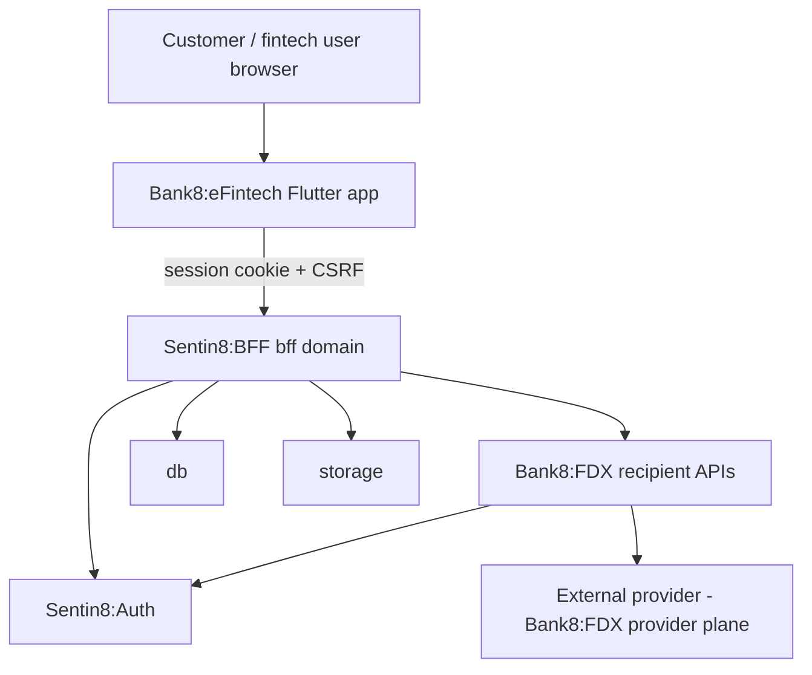
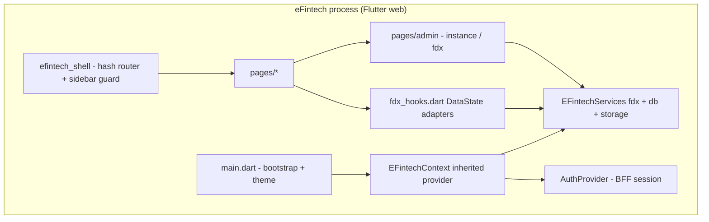
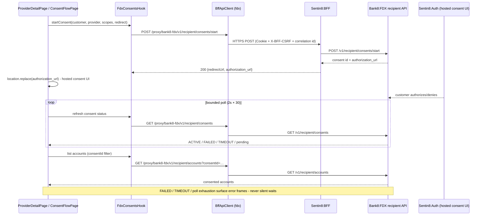
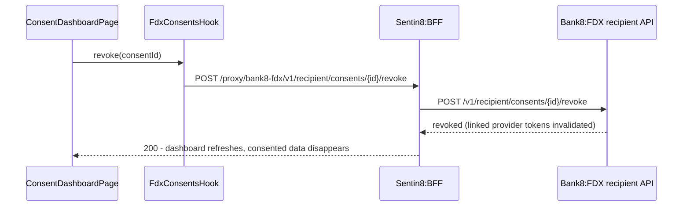
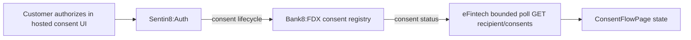
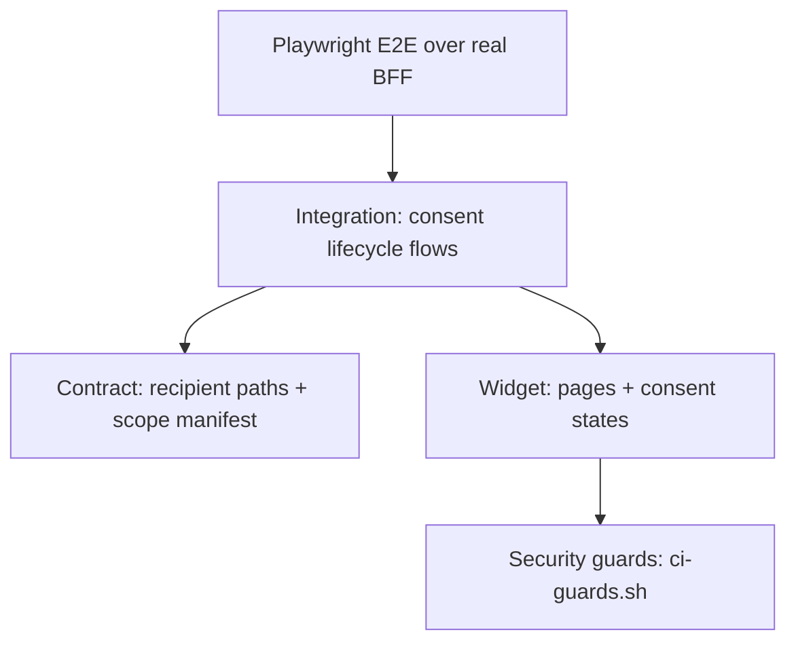

# Bank8:eFintech - Detailed Design Document

Overview-level material lives in `README.md`; the business view lives in
`BUSINESS.md`.

## 1. Scope & Context

**What eFintech owns:** the recipient-side presentation layer; the
client-side state composition (`EFintechContext`); the FDX recipient
journeys (provider catalog, provider detail, consent flow/monitoring,
consented accounts + transactions); the admin surface (instance overview,
FDX recipient-side administration); the listing manifest (`app8-listing.json`,
mirrored in `app.json`) and BFF scope whitelist (`bff8/scope_whitelist.rs`).

**What eFintech does NOT own (delegates):** identity and the hosted consent
UI (Sentin8:Auth); the FDX data plane, consent enforcement, and retrieval
(Bank8:FDX); persistence and object access (Sentin8:DB, storage - via BFF);
session/token custody (Sentin8:BFF); any ledger/payments surface (a recipient
never touches the provider's core directly).

## 2. Runtime Architecture

Request lifecycle (consent start → poll → display data):

Request lifecycle (revoke a consent):

## 3. Data Model

eFintech persists **no tables of its own**. All state is service-owned and
referenced by id:

| Domain object | Owned by | eFintech access |
|---|---|---|
| Provider catalog entries | Bank8:FDX (`sentin8_app_store_listings` / provider profile registry) | read via `GET /v1/recipient/providers` |
| Consents (customer ↔ provider) | Bank8:FDX consent registry | start/poll/revoke/refresh via `/v1/recipient/consents*` |
| Consented accounts + transaction snapshots | Bank8:FDX retrieval of provider data | read via `/v1/recipient/accounts(/{id}/transactions)` |

The client keeps only ephemeral UI state (selected provider, in-flight
consent, current route). No local persistence beyond the browser session.

## 4. API Surface

All backend calls are BFF-proxied (`https://{bff}/proxy/{service}/path`); the
app itself has no listening port.

| Consumer | Method + path (via BFF) | Gate | Notes |
|---|---|---|---|
| Provider discovery | `GET /proxy/bank8-fdx/v1/recipient/providers` | customer session; `bank8:fdx:recipient:read` | provider catalog |
| Consent start | `POST /v1/recipient/consents/start` | customer session; `bank8:fdx:recipient:write` | returns `redirectUrl`/`authorization_url` |
| Consent tracking | `GET /v1/recipient/consents` | customer session; `bank8:fdx:recipient:read` | status polling + dashboard |
| Consent revoke | `POST /v1/recipient/consents/{id}/revoke` | customer session; `bank8:fdx:recipient:write` | revokes sharing + linked tokens |
| Consent refresh | `POST /v1/recipient/consents/{id}/refresh` | customer session; `bank8:fdx:recipient:write` | re-authorization journey |
| Consented accounts | `GET /v1/recipient/accounts?consentId=…` | customer session; `bank8:fdx:recipient:read` | consent-scoped |
| Consented transactions | `GET /v1/recipient/accounts/{id}/transactions` | customer session; `bank8:fdx:recipient:read` | paginated snapshots |
| Admin instance | runtime context only | staff | no backend calls |
| Admin FDX | hooks as above | staff | recipient-side monitoring |

Event flow eFintech participates in (consumer side only; consent lifecycle
events are emitted upstream by Bank8:FDX and reflected by polling):

## 5. Cross-Cutting Concerns

- **Authentication / token custody.** BFF session cookie only; OAuth tokens
  attach server-side. Provider access tokens never exist in this app -
  Bank8:FDX holds the retrieval credentials.
- **Tenant resolution.** Fail-closed runtime-context bootstrap from own
  origin, identical to the other apps.
- **Authorization.** Recipient routes gate on `bank8:fdx:recipient:read/write`;
  admin routes require staff authorization resolved by the BFF. Consent
  status of *other* customers is never fetchable through this app's surface.
- **Consent minimization.** Only the requested FDX scopes are asked at
  start (`accountbasic`, `accountdetailed`, `transactions` reads); the app
  renders only what the consent allows.
- **Correlation.** `x-sentin8-correlation-id` on every proxy call; shared
  `AppLogger` entries under the same id.
- **TLS.** All calls are `https://`; consent redirects ride the hosted
  authorization domain over TLS.

## 6. Failure Modes & Recovery

- **Bootstrap failure** → error page (fail closed).
- **Consent poll exhaustion** (30 × 2s without a terminal state) → surfaced
  error frame; the customer restarts the journey from the dashboard (the
  pending consent remains visible there).
- **Consent FAILED/TIMEOUT** → the status is rendered with an explanatory
  state; a refresh or a fresh start attempt is offered.
- **Revocation race** - revoke returns success upstream; the following list
  refresh removes the consent and its data from view even if the customer is
  on a stale page.
- **Provider unreachable** (data plane) → retrieval snapshots fail upstream;
  the app surfaces empty/error frames - it never cache-serves stale financial
  data.

## 7. Concurrency & Performance Model

- Single Flutter web isolate; all I/O async through the three `BffApiClient`s.
- One bounded poll loop per in-flight consent (`ConsentFlowPage`); no global
  polling. Dashboard refreshes are page-enter driven.
- Transaction pages are paginated; large histories fetch incrementally.
- No SSE/WebSocket usage in this app (consent status polling is the only
  long-running interaction).

## 8. Invariants, Insecure-Defaults Rejected, Unsafe Rationale

- No direct external provider calls from the app - all FDX access is via the
  Bank8:FDX recipient APIs through the BFF (CI guard `scripts/ci-guards.sh`
  enforces; direct provider HTTP is a hard failure).
- No OAuth or provider token is ever present in the client.
- Data outside a consenting relationship is never rendered (consent-scoped
  reads only).
- Unknown hostname / failed runtime context = fatal, never defaulted.
- No `unsafe` code exists in this app (pure Dart, no FFI).

## 9. Testing Strategy

| Layer | Ownership | Tooling |
|---|---|---|
| Widget tests | page rendering, consent-state visuals | `flutter_test` (`test/widget_test.dart`) |
| Contract tests | recipient path composition + scope whitelist shape | `test/contract_test.dart`, `bff8/scope_whitelist.rs` |
| Integration tests | consent lifecycle against a stubbed fdx client (start → poll → active; revoke → data gone) | `test/integration_test.dart` |
| Security tests | no direct provider calls, no token on client, fail-closed bootstrap | `test/security_test.dart` + `scripts/ci-guards.sh` |
| E2E (UI only) | customer sign-up → consent flow → consented data display inside `e2e-ts` lifecycle | Playwright + Flutter semantics bridge |

Not tested here (platform scope): consent enforcement internals, provider
token custody, retrieval scheduling, CSDF minimization - covered by
Bank8:FDX's own suites.

## 10. Open Questions

- Recipient-initiated payment (money movement write) is a future FDX
  capability - the current app is strictly data-read.
- Background aggregate refresh of consented accounts may move to a
  platform-scheduled retrieval job instead of client-pull; undecided.

---

**Architecture & Design:** bank8:efintech and its underlying concepts were designed by [Hamid Jahanzad](https://www.linkedin.com/in/hamidjahanzad/).

