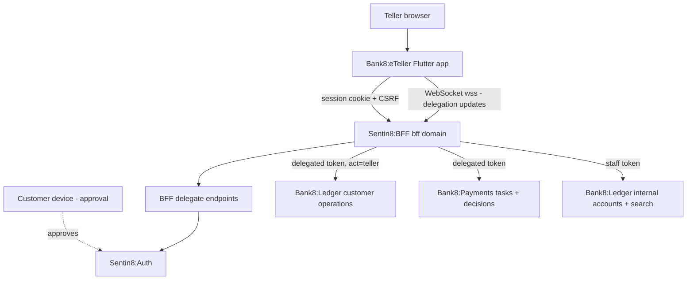
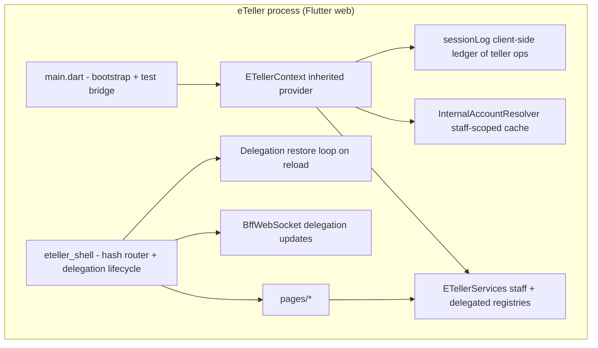
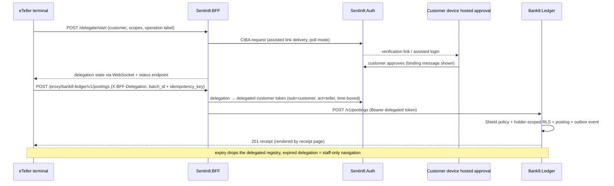
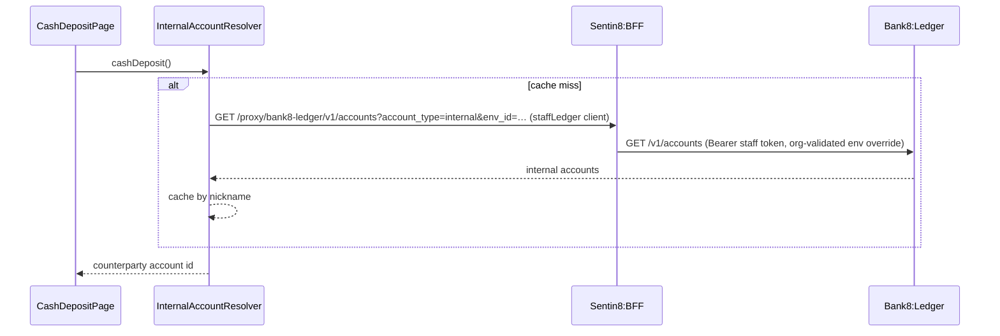
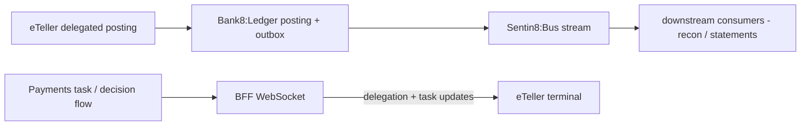
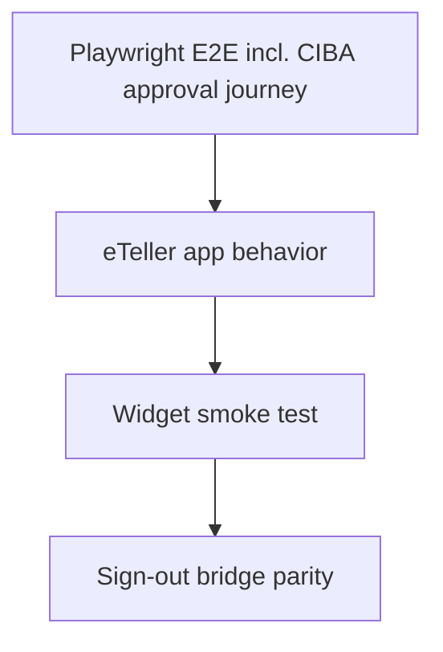

# Bank8:eTeller - Detailed Design Document

Overview-level material lives in `README.md`; the business view lives in
`BUSINESS.md`. This document carries the wire-level app contract: the OAuth
scope manifest, the CIBA delegation declaration, the BFF delegation surface,
routing, and internal invariants.

## 1. Scope & Context

**What eTeller owns:** the staff terminal presentation layer; the client-side
state composition (`ETellerContext`) including the internal-account resolver
and session log; the delegation UX (choice, status, expiry); teller journeys
(operations, batches, DLQ, decisions, tasks); the listing manifest
(`app8-listing.json`; `app.json` mirrors it); the E2E sign-out bridge.

**What eTeller does NOT own (delegates):** identity and delegation approval
UI (Sentin8:Auth hosted surfaces); the delegation gateway and delegated-token
issuance (Sentin8:BFF `/delegate/*`); financial truth (Bank8:Ledger);
payment tasks/decision state (Bank8:Payments); persistence (Sentin8:DB via
BFF); policy decisions (Shield in each backend).

## 2. Runtime Architecture

Request lifecycle (CIBA delegation → delegated posting):

Request lifecycle (staff-only internal-account resolution):

## 3. Data Model

eTeller persists **no tables of its own**:

| Domain object | Owned by | eTeller access |
|---|---|---|
| Customers + accounts | Bank8:Ledger | search/create (`/v1/customers*`), account mgmt (`PUT /v1/accounts/{id}`) |
| Products | Bank8:Ledger | read for account opening (`GET /v1/products`) |
| Postings + batches | Bank8:Ledger | delegated postings (`POST /v1/postings`); batch review (`GET /v1/postings`) |
| Internal accounts | Bank8:Ledger | staff-only read via `account_type=internal` |
| Statements | Bank8:Ledger + storage | list via `/v1/accounts/{id}/statements`; signed reads |
| DLQ entries | Bank8:Ledger | ops view + republish (`/v1/dlq*`) |
| Manual decisions | Bank8:Payments | review + submit (`/v1/manual-decisions*`) |
| Approval tasks | Bank8:Payments | act (`/v1/tasks*`) |
| Delegations | Sentin8:BFF `/delegate/*` + Sentin8:Auth | start/status via BFF; the id is cached client-side (id only) |

Client-resident state: `sessionStorage` delegation id (+ companions), the
in-memory `sessionLog` (per-shift teller operations), and the
internal-account nickname cache. No tokens are stored client-side.

## 4. API Surface

All backend calls are BFF-proxied; the app has no listening port.

**Staff-token surface (never delegation-stamped):**

| Consumer | Method + path (via BFF) | Gate | Notes |
|---|---|---|---|
| Customer search | `GET /proxy/bank8-ledger/v1/customers` | staff; `bank8:ledger:customers:write` | find customers |
| Customer onboarding | `POST /v1/customers` | staff | create customer |
| Internal accounts | `GET /v1/accounts?account_type=internal&env_id=…` | staff; org-validated env override | counterparty resolution |
| Shift summary | client-side (`sessionLog`) | staff | no backend read |
| Batch review | `GET /v1/postings`, `GET /v1/postings/{id}/instructions` | staff; `bank8:ledger:postings:read` | committed batches |
| DLQ ops | `GET /v1/dlq`, `POST /v1/dlq/{id}/republish` | staff; `bank8:ledger:dlq:read/republish` | ops surface |
| Approval tasks | `GET /proxy/bank8-payments/v1/tasks`, `POST /v1/tasks/{id}/{action}` | staff; `bank8:payments:tasks:read/write/approve` | approvals |
| Manual decisions | `GET /v1/manual-decisions`, `POST /v1/manual-decisions/{id}/submit` | staff; `bank8:payments:manual-decisions:read/write` | decisions |

**Delegated (CIBA) customer surface - `X-BFF-Delegation` on every call:**

| Consumer | Method + path (via BFF) | Delegated customer scope |
|---|---|---|
| Cash deposit | `POST /proxy/bank8-ledger/v1/postings` (`inbound_hard_settlement` → cash internal account) | `bank8:ledger:postings:write` |
| Cheque deposit | `POST /v1/postings` (`inbound_authorisation` → cheque-clearing account) | `bank8:ledger:postings:write` |
| Withdrawal | `POST /v1/postings` (`outbound_hard_settlement` → cash account) | `bank8:ledger:postings:write` |
| Teller transfer | `POST /v1/postings` (`transfer`) | `bank8:ledger:postings:write` |
| Account management | `GET /v1/accounts?customer_id=…`, `PUT /v1/accounts/{id}` | `bank8:ledger:accounts:read/write` |
| Statements | `GET /v1/accounts/{id}/statements` | `bank8:ledger:accounts:read` |
| Customer detail | `GET /v1/customers/{id}` | delegated read path |

**Delegation lifecycle (BFF-own endpoints, not proxied):**
`POST /delegate/start`, `GET /delegate/status?delegation_id=…`; live updates
ride the BFF WebSocket (`/ws`).

**OAuth scope manifest** (`app8-listing.json`; `app.json` mirrors it): 32
scopes - identity (`openid`, `profile`, `email`); ledger (accounts
read/write + `write:any`, balances, customers write, DLQ read/republish,
postings read/write, products read/write, schedules read/write, audit read);
payments (cards, files, instructions, mandates, manual-decisions, payments,
routing, tasks read/write/approve). Grants: `authorization_code`,
`refresh_token`, `urn:openid:params:grant-type:ciba`.

**CIBA declaration (`ciba_defaults`):** delivery `assisted_link`, request
mode `poll`, expiry 300 s, poll interval 5 s, binding-message template
`eTeller request from {teller_name} - {operation_label}`, and the delegated
customer scope subset (accounts/postings/balances/customers read, products,
instructions, cards, mandates).

Event flow eTeller participates in:

## 5. Cross-Cutting Concerns

- **Authentication.** Teller session = BFF cookie; delegated customer
  authority = BFF-issued delegated token bound to the delegation id (`act`
  claims the teller). No token ever lives in the client.
- **Tenant resolution.** Fail-closed runtime-context bootstrap (own origin);
  the staff env override for internal accounts is validated against org
  membership by the BFF/ledger, never trusted from the client.
- **Authorization.** Three staff-token-only operations; customer operations
  require delegation - enforced by the BFF + downstream services, never by
  hidden UI. The delegated scope subset is narrower than the staff manifest.
- **Idempotency.** Every posting carries `batch_id` + `idempotency_key`;
  retry loops (deposits/withdrawals) reuse the same key.
- **Audit.** Delegated operations are `act`-attributed end to end; teller
  actions land in the service audit journals upstream.
- **Realtime.** BFF WebSocket for delegation/task updates; the terminal
  reconnects on drop and falls back to the status endpoint.
- **TLS.** All traffic `https://` / `wss://`.

## 6. Failure Modes & Recovery

- **Delegation expiry mid-journey** → the delegated registry drops; UI falls
  back to staff-only navigation; the operation must be re-delegated (never
  silently retried).
- **Reload mid-delegation** → restore loop revalidates against
  `/delegate/status` with bounded retries; success resumes, failure clears.
- **Posting failure** → the operation page keeps state and retries the same
  idempotency key; failures surface inline.
- **WebSocket drop** → reconnect with backoff; the status endpoint is the
  fallback truth.
- **DLQ accumulation** → ops page lists landed messages; republish is a
  deliberate, staff action.
- **Bootstrap failure** → error page (fail closed).

## 7. Concurrency & Performance Model

- Single Flutter web isolate; per-registry clients keep staff and delegated
  traffic independent.
- One active delegation at a time; delegation state transitions are
  serialized through the shell's lifecycle handler.
- The `sessionLog` is append-only in memory; the shift summary aggregates at
  render time.
- Internal-account resolution is cached per session (map by nickname);
  cache scope is staff-side and unaffected by delegation changes.

## 8. Invariants, Insecure-Defaults Rejected, Unsafe Rationale

- The teller never holds customer credentials or delegated tokens - only the
  delegation id (in `sessionStorage`), never secret material.
- Customer-data operations without an active delegation are impossible (the
  delegated registry does not exist until `delegatedCustomer` is built).
- Internal accounts are reachable **only** through `staffLedger` (staff
  token), never through the delegated client.
- Exactly three staff-token-only operations; everything else delegated.
- Unknown hostname / failed runtime context = fatal, never defaulted.
- Password-sharing / "act-as" flows are rejected by design
  (unattributable, unauditable).
- No `unsafe` code exists in this app (pure Dart, no FFI).

## 9. Testing Strategy

| Layer | Ownership | Tooling |
|---|---|---|
| Widget tests | smoke-level (`test/widget_test.dart`) | `flutter_test` |
| Delegation lifecycle | covered at E2E layer (choice → approval → delegated posting → expiry) | Playwright + Flutter semantics bridge |
| E2E (UI only) | teller journey inside `e2e-ts` lifecycle (teller signs in, CIBA delegation approved from customer session, cash deposit, receipt) | Playwright |
| Sign-out parity | `test_bridge.dart` guarantees E2E exercises the same sign-out path as the user menu | E2E |

Not tested here (platform scope): CIBA token issuance, delegation gateway
state machine, ledger posting math, RLS isolation - covered by the owning
services' suites.

## 10. Open Questions

- Cheque clearing settlement (cleared/bounced) should conclude through the
  ledger cheque pipeline rather than the client log - the durable half of
  that flow is the known gap.
- Cash-drawer balancing / end-of-day reconciliation may deserve a
  server-side session record instead of the client-side `sessionLog`.

### Appendix: OAuth scope manifest (full list)

`app8-listing.json` carries 32 scopes - every one has a real handler gate in
the service registries:

- **Identity (OpenID Connect)** - 3: `openid`, `profile`, `email`
- **Ledger** - 12: `bank8:ledger:accounts:read/write`,
  `bank8:ledger:balances:read`, `bank8:ledger:customers:write`,
  `bank8:ledger:dlq:read/republish`, `bank8:ledger:postings:read/write`,
  `bank8:ledger:products:read/write`, `bank8:ledger:schedules:read/write`,
  `bank8:ledger:audit:read`
- **Payments** - 17: `bank8:payments:cards:read/write`,
  `bank8:payments:files:read/write`,
  `bank8:payments:instructions:read/write`,
  `bank8:payments:mandates:read/write`,
  `bank8:payments:manual-decisions:read/write`,
  `bank8:payments:payments:read/write`, `bank8:payments:routing:read`,
  `bank8:payments:tasks:read/write/approve`

---

**Architecture & Design:** bank8:eteller and its underlying concepts were designed by [Hamid Jahanzad](https://www.linkedin.com/in/hamidjahanzad/).

