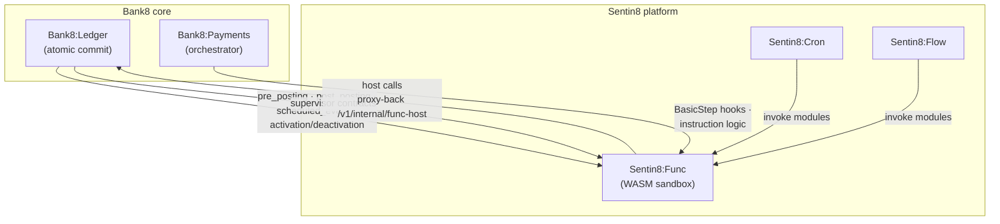

# Extending Bank8: the edge-function model

Most cores that promise "extensibility" embed a scripting engine
inside the transaction loop: one bad script can steal the ledger's
CPU, corrupt its state machine, or take the whole core down with it.
Bank8 takes the opposite path - **the core ledger contains no product
code and no script engine at all**. Custom banking logic compiles to
WebAssembly and runs in **Sentin8:Func**, the platform's dedicated
edge-function execution service, invoked asynchronously from well-defined
ledger hooks.

## The wire



The ledger fires a hook **around** its atomic commit - never inside
it. A hook receives a self-contained event envelope (`hook`, account,
posting, parameters), executes in an isolated WASM sandbox, and can
call back into the ledger's internal API for domain facts or money
movement. The commit itself is untouched by hook code: `posting →
balance validation → audit + outbox` happens in one transaction before
or after the module runs, so a crash, timeout, or fuel-exhausted module
can never corrupt a money position.

## The sandbox (total blast-radius isolation)

Sentin8:Func gives every module hard resource bounds - not advisory
ones:

| Boundary | Enforcement |
|---|---|
| Memory | WASM linear memory only + a `ResourceLimiter` cap; no host memory is reachable |
| CPU | Fuel metering (instruction cap) - infinite loops die deterministically |
| Wall clock | wasmtime epoch interruption deadline per invocation |
| Filesystem / network | **WASI is rejected outright** during validation (`wasi_snapshot_preview1`/`wasi`/`wasi_unstable` imports are all refused); the only I/O is the explicit host-function callback |
| Imports | Built-in namespace only (`malloc`, `free`, `log`, `util_now`, `util_date_add`, `util_round`) plus the `CallbackConfig` host functions the registering service declared |
| Validation | Upload-time validate step: parse, reject WASI, verify declared hooks are exported, verify every import is covered by the declared host map |

The trust boundary is structural: **a malicious or buggy module cannot
escape the sandbox - linear memory only, no WASI, imports restricted
to the builtin namespace or declared host functions.** A runtime crash
inside the module surfaces as a structured error to the caller; the
ledger's posting transaction is unaffected. This is why the core ledger
has *no WASM runtime of its own* - the ledger implements only the
proxy-back handler (`POST /v1/internal/func-host`), and the sandbox
lives on the platform side.

## Hook points on the core ledger

| Hook | Fires | Canonical uses |
|---|---|---|
| `pre_posting` | before each posting instruction commits | velocity limits, blocking holds, compliance pre-checks |
| `post_posting` | after a posting batch commits | loyalty accrual, fee nudges, notification fan-out |
| `scheduled_event` | on a scheduled trigger (interest accrual, fees) | tier-3 pricing, dormancy penalties |
| `activation` / `deactivation` | account status transitions | welcome hooks, closing balances |
| supervisor contracts | cross-account sweeps / rebalancing | sweep logic as a versioned module |

Every product version can pin its own module (the ledger's
`product_versions` table is a first-class WASM registry: `wasm_hash`,
size, source language, declared hooks, per-version parameters, with
`pending` → `active` version pointer), and `POST /v1/contracts/simulate`
runs a module against synthetic account state before it ever receives
live traffic. Supervisor contracts (sweeps, rebalancing) bind a module
id directly (`func_module_id`), with dry-run simulation through the
same pipeline.

## Polyglot authoring

Modules are standard WASM binaries, so any toolchain that lowers to
WebAssembly works - no proprietary DSL, no vendor scripting language.
The core ledger's product-version registry enumerates the first-class
targets today:

```sql
wasm_language  TEXT NOT NULL CHECK (wasm_language IN ('typescript', 'rust'))
```

**Rust** and **TypeScript** (via AssemblyScript-style lowering) ship
as curated first-class targets; **any WASM-producing language** (Go,
C, C++, AssemblyScript, …) works because Func consumes standard WASM
binaries - the language field is metadata, not a gate.

## Deployment without downtime

Product logic is deployed like configuration, not like a release:

1. **Upload** - `POST /v1/modules` (Func): base64 WASM + source
   language + declared hooks. Modules live content-addressed
   (sha256) in Sentin8:Storage.
2. **Validate** - `POST /v1/modules/{id}/validate`: parse, reject
   WASI, verify exports and import coverage.
3. **Simulate** - `POST /v1/contracts/simulate` (ledger): run the
   module against synthetic state; results are journaled, nothing
   touches domain rows.
4. **Activate** - `POST /v1/modules/{id}/activate`: the module moves
   `draft → active` and supersedes the previous active pointer per
   `(domain, product)` - serving traffic continues with **no service
   restart**; identical re-uploads de-duplicate to the existing
   version.
5. **Bind** - point a product version, schedule, or payment step at
   the new module id; the bank8:payments lifecycle even offers
   `POST /v1/logics/{id}/migrate-wasm` to walk an instruction logic's
   inline hooks into Func modules automatically.
6. **Retire** - `draft/deprecated` modules delete freely; an active
   module must be deprecated first, so traffic never tears down mid-flight.

Every executed hook is deterministic and idempotent - replays return
the recorded result within the dedupe window - so deploying a fee
update in the middle of a business day is a data operation, not a
change window.

## Why async-adjacent beats in-loop scripting

| Concern | Embedded script engines | Bank8 edge functions |
|---|---|---|
| Blast radius | script bug stalls or corrupts the transaction loop | sandboxed module fails alone, ledger commit unaffected |
| Languages | engine-specific | any WASM producer (Rust, TypeScript first-class) |
| Versioning | shared interpreter globals | per-version modules, `pending → active` pointer |
| Testing | mostly manual | `contracts/simulate` before activation, journaled |
| Resource safety | whatever the engine allows | fuel + memory + epoch deadline + import allowlist |

The ledger enforces its own invariants regardless of what the module
returns: even if a hook asks the ledger to create a posting through the
proxy-back endpoint, the instruction re-enters the same validation
pipeline - unbalanced batches are still rejected 422, idempotency keys
still dedupe, and every money-moving host call still rides the M2M
certificate identity. Extension never relaxes the core.

## Getting started

```bash
# 1. Author a hook (Rust)
cargo +nightly build --target wasm32-unknown-unknown   # exports pre_posting

# 2. Upload + validate + activate on Sentin8:Func
curl -X POST https://api.internal/v1/modules -d '{ "wasm_binary": "…", "wasm_language": "rust", "hooks": ["pre_posting"] }'
curl -X POST https://api.internal/v1/modules/{id}/validate
curl -X POST https://api.internal/v1/modules/{id}/activate

# 3. Simulate against synthetic state before binding live traffic
curl -X POST https://api.internal/v1/contracts/simulate -d '{ "module_id": "…", "hook": "pre_posting", "input": { … } }'
```

For the platform-side service (its own API, sandbox implementation, and
lifecycle discipline), read the
[Sentin8:Func page](https://sentin8.dev/docs/services/func). For the
ledger-side contract (hooks, product-version registry, proxy-back), see
[Bank8:Ledger](/docs/products/ledger).