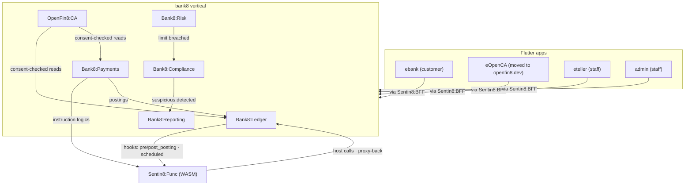

# Bank8 - the finance vertical

Bank8 is banking, payments, and open banking composed on the Sentin8
platform: six Rust services that own the bank8 database, a unified Rust
SDK facade, and four Flutter apps. It contains **no platform
infrastructure of its own** - identity, events, storage, scheduling,
workflows, and supervision are consumed from the platform, so every
service inherits the authorization pipeline and audit posture.

## The products

| Product | Role |
|---|---|
| [Ledger](/docs/products/ledger) | core ledger - accounts, products, postings, balances |
| [Payments](/docs/products/payments) | orchestration over ISO 20022 schemes, cards, mandates |
| [Open Banking](https://openfin8.dev/) (the OpenFin8 vertical) | consent-checked data sharing - composed from the openfin8 vertical |
| [Reporting](/docs/products/reporting) | regulatory filings - calendar, generation, submission |
| [Risk](/docs/products/risk) | prudential risk - capital, liquidity, limits, ECL |
| [Compliance](/docs/products/compliance) | AML/CTF - KYC, screening, monitoring, cases |
| Edge functions ([extensibility](/docs/extensibility)) | product logic as isolated WASM on Sentin8:Func - the product factory's hook plane |

## Extending Bank8: edge functions

Bank8 decouples the core ledger from product logic. Custom banking
behavior - fee hooks, tiered interest, velocity limits, sweeps -
compiles to WASM and runs in **Sentin8:Func**, the platform's isolated
edge-function service. The ledger fires `pre_posting` / `post_posting` /
`scheduled_event` / activation hooks around its atomic commit, and the
sandbox calls back through a certificate-bound host-function endpoint.
Modules are polyglot (Rust and TypeScript first-class, any WASM producer
beyond that), deployed as data operations (`upload → validate →
simulate → activate`, **no core restart**), and can never touch money
movement except through the same validation pipeline every posting
rides. Read [Extending Bank8](/docs/extensibility).

## Security

Bank8 inherits the platform's five pillars - post-quantum TLS, one
identity plane, live Shield authorization, FORCE-RLS tenant isolation,
certificate-only workload identity - and adds its own invariants:
double-entry balance validation before any write, consent middleware on
every FDX call, and secret references only (no PAN/PIN/CVV anywhere).
Read the [security page](/docs/security).

## Who builds on bank8

Other verticals delegate their money movement here: hotel8's property
commerce and bill8's billing settlement both ride
[Bank8:Payments](/docs/products/payments).