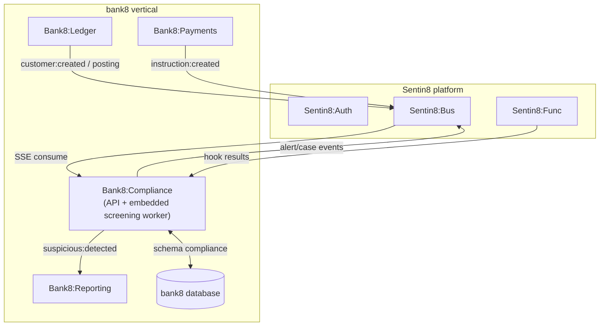
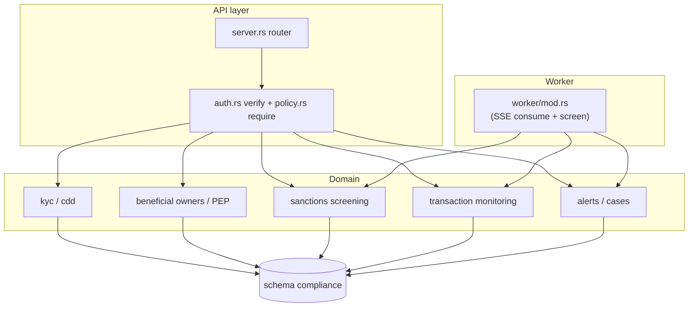
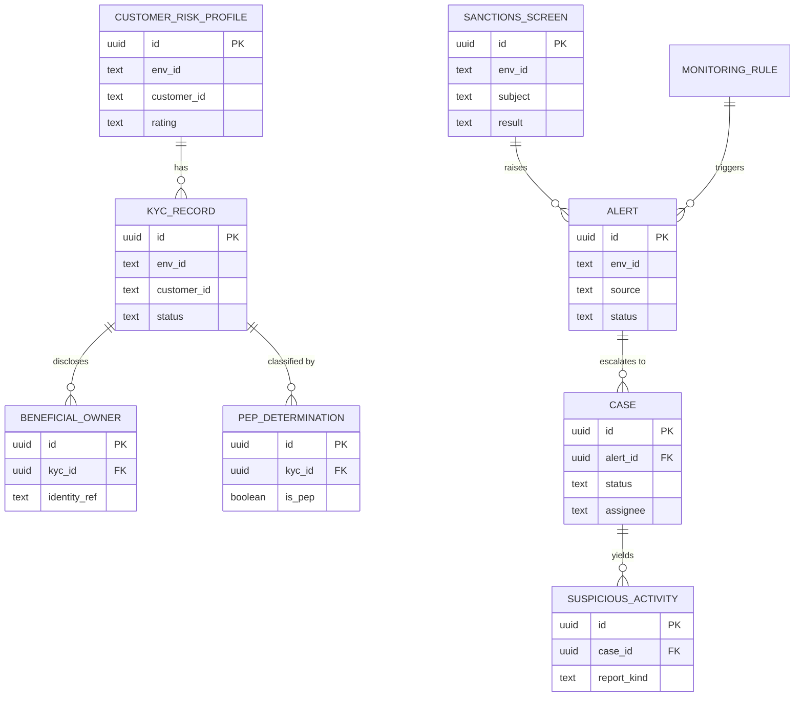
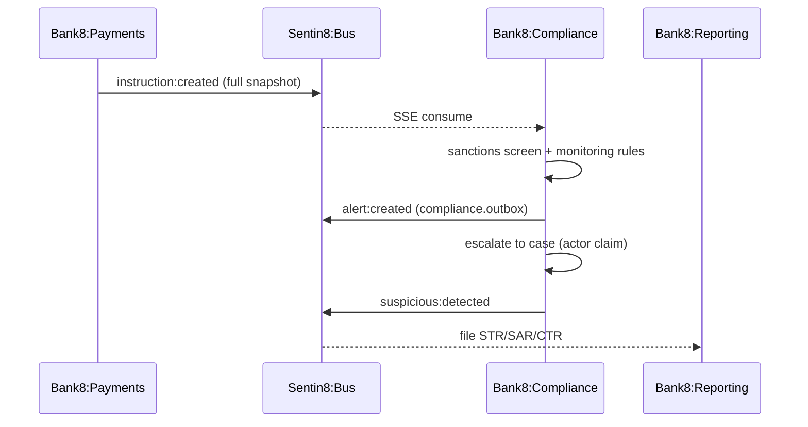
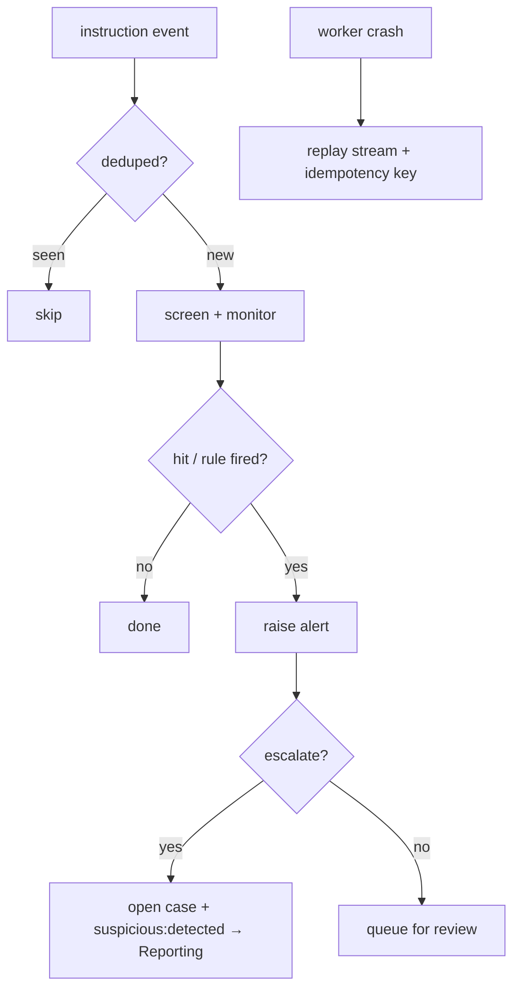

# Bank8:Compliance - Detailed Design Document

## 1. Scope & Context

Bank8:Compliance owns: the `compliance` schema (schema-per-service -
domain tables + `compliance.outbox` / `compliance.audit_journal`
producer tables), the KYC/CDD/AML REST API, the sanctions + transaction
screening worker, the alert/case lifecycle, and the
`bank8:compliance:*` event family.

It does NOT own: filing to regulators (Bank8:Reporting), money movement
(Bank8:Ledger/Payments), tenant-authored hook execution (Sentin8:Func -
consumed as results), or watchlist source curation (the jurisdiction
registry provides snapshots; list ingestion is a platform concern).

## 2. Runtime Architecture

Shell-owned boot plus one service-spawned task: the embedded screening
worker (a Bus SSE consumer on the `payments`/`ledger` families that runs
sanctions screening and monitoring rules, raises alerts, and emits
`suspicious:detected` toward Reporting).

Access-decision order (principles §4.7 - **membus → bus → owner
API**): (1) MemBus state refresh first - alert-queue/screening state
publishes newest-wins ephemeral notifications (`sentin8::membus::ServiceBus`,
fail-soft) so queue dashboards refresh surgically; (2) durable, audited
`bank8:compliance:*` events via the local outbox → relay → Bus
`POST /v1/produce` - `suspicious:detected` trigger delivery to Reporting
rides this tier; (3) owner HTTP APIs only for synchronous
read-your-writes (e.g. KYC rating decisions). Detection inputs are Bus
events (`instruction:created`, `customer:created`) carrying the full
domain snapshot - never cross-service table reads.

## 3. Data Model

All tables env-scoped + RLS-enforced (`FORCE ROW LEVEL SECURITY`,
`env_id` match); `MONITORING_RULE` thresholds are registry-derived.
Identity references (beneficial owner, watchlist matches) are
reference-only.

## 4. API Surface

| Audience | Routes | Auth gate | Events emitted |
|---|---|---|---|
| Public | `POST/GET /v1/customers/{id}/kyc`, `POST/GET /v1/customers/{id}/beneficial-owners` (identity by `sentin8-secrets://` reference only - enforced at the handler), `POST /v1/customers/{id}/pep` (one live determination per KYC record), `POST /v1/customers/{id}/risk-profile` (mandatory rationale; PEP forces ≥ high), `GET /v1/alerts`, `POST /v1/alerts/{id}/status` (claim/review/close - guarded against terminal states), `POST /v1/alerts/{id}/case` (audited actor claim), `GET /v1/cases/{id}`, `GET /v1/cases/{id}/evidence` (alert + subject screens - read-only), `POST /v1/cases/{id}/conclude` (→ suspicious_activities + handoff), `POST /v1/cases/{id}/dismiss` (mandatory reason - no handoff, terminal), `GET /v1/rules` | `bank8:compliance:{kyc,alerts,cases}:{read,write}` via Shield | `bank8:compliance:{kyc:created,kyc:beneficial_owner:disclosed,kyc:pep:determined,kyc:risk_profile:upserted,alert:created,alert:updated,case:opened,case:dismissed,suspicious:detected}` |
| Admin/RFW | `GET /v1/admin/ui/{page}`, `GET /v1/admin/overview` | `bank8:compliance:admin` | - |

`suspicious:detected` is emitted exactly once per (case, report kind) -
the report kind validates against the shared `ReportKind` vocabulary
before any write; Reporting consumes it as its AML filing trigger
(single filing executor - Compliance never files). A dismissed case is
terminal and emits nothing toward Reporting; a new detection opens a
new case.

## 5. Cross-Cutting Concerns

- **Auth**: Sentin8:Auth-issued tokens verified; Shield against live
  roles; `scope` is a pre-filter.
- **Identity - no token envs.** The worker's certificate-presenting Bus
  client is the single outbound identity (CERTFREE-4V - single identity
  plane, principles §4.1); config carries URLs only. A failed certificate
  mint fails the consume closed - there is no static-token fallback
  anywhere.
- **Event emission (membus → bus → API)**: every alert/case/screening
  change publishes the MemBus state refresh first (fail-soft), then the
  durable outbox row; `suspicious:detected` reaches Reporting via Bus
  - Compliance never files and never touches Reporting's tables.
- **Tenant + RLS**: `set_tenant_context` awaited on the same connection;
  explicit `WHERE env_id = $N`.
- **Idempotency**: screening is idempotent per (event idempotency_key);
  an alert is raised at most once per (subject, rule, window).
- **Audit**: `compliance.audit_journal` in the same transaction + Sys
  audit push; case actor claims are audited.
- **TLS**: PQ-TLS via `sentin8-tls`.

## 6. Failure Modes & Recovery

## 7. Concurrency & Performance Model

Pool capped at 3. Screening is a bounded lookup against a watchlist
snapshot (in-memory, TTL-cached) plus a rule evaluation; the hot path is
an UPSERT of the screen result. Backpressure via Valkey consumer group
ACK.

## 8. Invariants

- An alert is raised at most once per (subject, rule, window).
- `suspicious:detected` is emitted exactly once per case; Reporting owns
  the filing.
- Compliance never writes ledger/payments tables; all inputs are events
  or public API reads.
- No watchlist secret or identity reference is stored as plaintext.

## 9. Testing Strategy

- **Contracts crate** - shared report-kind vocabulary.
- **Policy suite** (`tests/policy.rs`) - the real seeded scope-mirror
  text with the handler-action parity matrix (11 tests).
- **DB invariants** (`tests/db_invariants.rs`, all 5 pass against a live
  bank8 DB): FORCE-RLS rejection; at-most-once alert per (subject,
  rule, window); one live PEP determination per KYC record; idempotent
  beneficial-owner disclosure; at-most-once suspicious activity per
  (case, report kind) with distinct kinds as distinct filings.
- **E2E** - UI-only through the BFF (E2E-REG-1). Watchlist-source
  integration is out of scope (snapshot ingestion is platform).

## 10. Open Questions

- Watchlist snapshot ingestion cadence (near-real-time vs. daily).
- Alert deduplication windows per rule family.

---

**Architecture & Design:** bank8:compliance and its underlying concepts were designed by [Hamid Jahanzad](https://www.linkedin.com/in/hamidjahanzad/).

