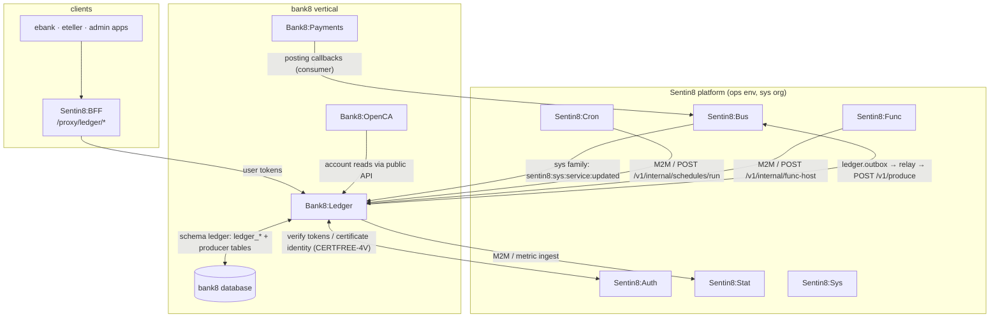
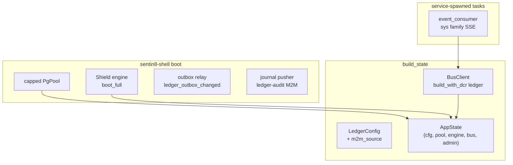
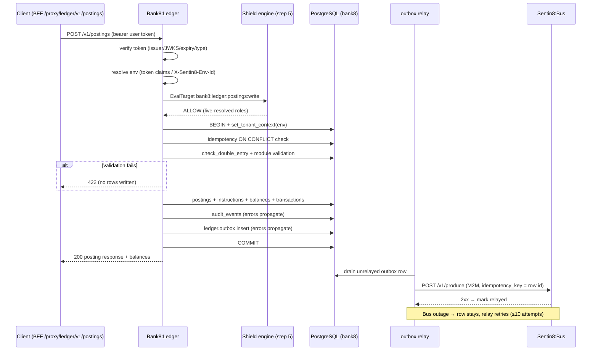
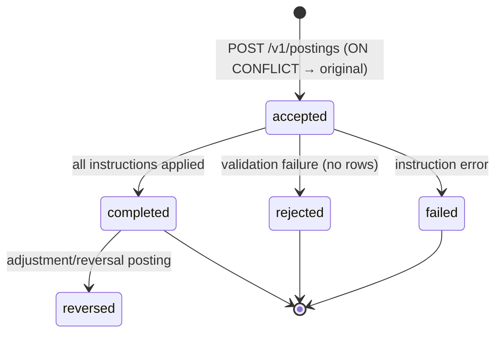
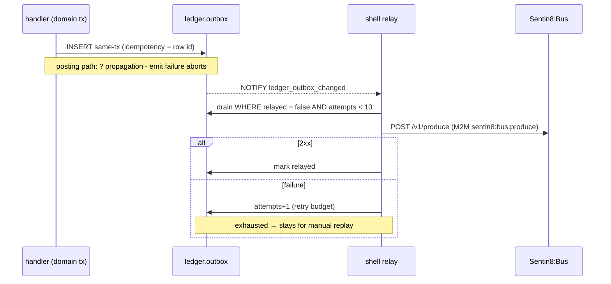
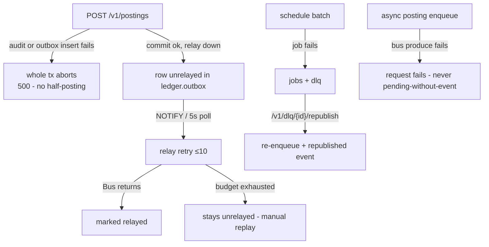
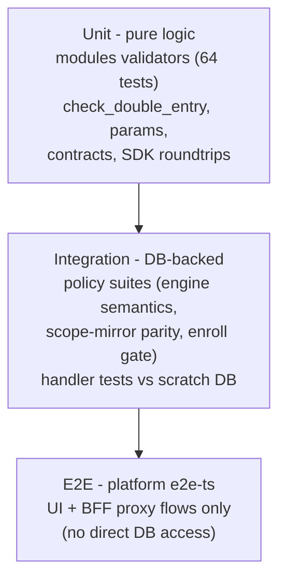

# Bank8:Ledger - Detailed Design Document

## 1. Scope & Context

Bank8:Ledger owns: the ledger domain schema in the bank8 vertical
database (44 domain tables in the `bank8` schema + the service leaf
schema `ledger` for the outbox and audit journal), the account /
product / posting / balance / schedule REST API (91 endpoints), the
product module validation library, the scheduled-posting engine, the
internal proxy-back handlers for Cron and Func, and the
`bank8:ledger:*` event family (30 event types).

It does NOT own: scheduling (Sentin8:Cron), tenant-authored executable
hooks (Sentin8:Func), workflow orchestration (Sentin8:Flow), analytics
telemetry (it only emits to Sentin8:Stat), or customer identity
(Sentin8:Auth is the identity provider; `customers` is a banking
record, optionally linked via `sentin8_auth_user_id`).

## 2. Runtime Architecture

Boot is shell-owned (`sentin8::shell`): pool, policy engine load
(fail-closed), outbox relay (step 8b), audit-journal pusher (step 8c),
TLS. `build_state` then adds the ledger's own wiring:

**Request lifecycle - synchronous posting** (the canonical family; every
other handler is a subset - auth verify, tenant resolve, policy gate,
context, execute, emit):

## 3. Data Model

44 domain tables in the service's own schema `ledger`
(schema-per-service), all `env_id`-scoped + FORCE-RLS; the same schema
carries the producer tables (`ledger.outbox`, `ledger.audit_journal`).

```mermaid
erDiagram
    customers ||--o{ accounts : "holds"
    products ||--o{ accounts : "typed by"
    accounts ||--o{ balances : "has"
    accounts ||--o{ transactions : "moves"
    postings ||--o{ posting_instructions : "contains"
    postings ||--o{ transactions : "produces"
    accounts ||--o{ statements : "receives"
    schedules ||--o{ jobs : "generates"
    calendars ||--o{ calendar_events : "defines"
    calendars ||--o{ calendar_periods : "defines"
    products ||--o{ product_versions : "versions"
    flags }o--|| flag_definitions : "instantiates"
    flags }o--|| accounts : "applies to"
    restriction_sets }o--|| restriction_definitions : "instantiates"
    restriction_sets }o--|| accounts : "applies to"
    parameters ||--o{ parameter_values : "resolves"
    parameter_values }o--o{ parameter_value_hierarchy_nodes : "hierarchy"
    plans ||--o{ plan_assocs : "associates"
    plans ||--o{ plan_migrations : "migrates"
    accounts ||--o{ account_flags : "flagged"
    accounts ||--o{ account_attributes : "attributed"
    accounts ||--o{ payment_devices : "pays via"
    adjustments }o--|| accounts : "corrects"
    postings ||--o{ journal_events : "journaled"
    supervisor_contracts }o--o{ accounts : "supervises"
    accounts ||--o{ account_migrations : "migrates"
    accounts ||--o{ account_update_batches : "batched"
    processing_groups ||--o{ accounts : "groups"
    accounts ||--o{ account_schedule_tags : "tagged"
    schedule_tags ||--o{ schedule_tag_assocs : "associates"
    ledger.outbox ||..|| ledger.audit_journal : "producer tables (same schema)"
```

Complete table inventory with purpose and visibility:

| Table | Purpose | RLS tier |
|---|---|---|
| `accounts` | Customer + internal accounts (`account_type`, `product_id`, nullable `customer_id` for internal) | holder-scoped |
| `products` / `product_versions` / `product_versions_ext` | Product library: type, parameters JSONB, modules list | env |
| `postings` / `posting_instructions` | Posting batches + instructions (`status`, `idempotency_key`, batch_id) | env |
| `balances` | Per (account, denomination, address, phase) amounts - UPSERT target | env |
| `transactions` | Per-account movement records (posting_id, direction) | env |
| `statements` | Generated statement metadata (payload in Storage) | env |
| `schedules` / `jobs` / `dlq` | Scheduled-posting engine + job log + local dead-letter | env |
| `customers` | Banking customer records (`sentin8_auth_user_id` nullable) | env |
| `flag_definitions` / `flags` / `account_flags` | Flag library + instances + account bindings | holder (flags) |
| `restriction_definitions` / `restriction_sets` | Restriction library + instances | holder (sets) |
| `parameters` / `parameter_values` / `parameter_value_hierarchy_nodes` / `global_parameters` | Parameter library + resolution hierarchy (global → product → account) | env |
| `calendars` / `calendar_events` / `calendar_periods` / `bookkeeping_dates` | Calendar model for value/booking dates | env |
| `plans` / `plan_assocs` / `plan_migrations` | Product plan assignment + migration batches | env |
| `processing_groups` | Account grouping for batch processing control (pause/resume) | env |
| `schedule_tags` / `schedule_tag_assocs` / `account_schedule_tags` / `account_schedule_assocs` | Schedule tagging for routing/selection | env |
| `journal_events` | Replayable domain journal (checksum chain) | env |
| `adjustments` | Post-posting corrections (reason, amount) | env |
| `supervisor_contracts` | Cross-account supervision contracts (Func module refs) | env |
| `payment_devices` / `account_attributes` | Account extras: device registry + KV attributes | env |
| `ledger_internal_accounts` (via accounts) | Seeded counterparty accounts (cash/cheque/liquidity/clearing/suspense per denomination) | env |
| `account_migrations` / `account_update_batches` | Bulk migration/update staging + bulk-retry | env |
| `audit_events` | Domain audit trail (actor, action, target) | env |
| `ledger.outbox` / `ledger.audit_journal` | Producer tables (relay/pusher drained) | FORCE |

**Posting lifecycle**:

**Instruction (async) lifecycle**: `pending → processing → completed |
failed | cancelled` - terminal states immutable (guarded updates).

## 4. API Surface

All 91 utoipa-declared endpoints, grouped by family with their
authorization gates (Shield step-5 targets; every handler also
`WHERE env_id` + RLS):

| Family | Endpoints | Gate |
|---|---|---|
| Accounts | `GET/POST /v1/accounts`, `GET /v1/accounts/{id}`, `…/balances`, `…/transactions`, `…/statements`, `…/schedules`, `…/attributes`, `…/devices`, `…/schedule-tags` | `bank8:ledger:accounts:read` / `:write` |
| Products | `GET/POST /v1/products`, `GET /v1/products/{id}`, `POST …/{id}/activate`, `…/{id}/versions` | `bank8:ledger:products:read` / `:write` / `:publish` |
| Postings | `POST /v1/postings`, `POST /v1/postings/async`, `GET /v1/postings/{id}`, `GET …/instructions`, `GET /v1/post-posting-failures`, `POST …/{id}/republish` | `bank8:ledger:postings:read` / `:write` / `:dry_run` |
| Balances v2 | `GET /v2/balances/live`, `/v2/balances/end`, `/v2/balances/series` | `bank8:ledger:balances:read` |
| Schedules | `GET/POST /v1/schedules`, `GET /v1/schedules/{id}`, `/v1/schedule-tags`, `…/{id}/assocs`, `/v1/account-schedule-tags` | `bank8:ledger:schedules:read` / `:write` |
| Jobs/DLQ | `GET /v1/jobs`, `…/{id}`, `POST …/{id}/retry`, `…:batchRepublish`, `GET /v1/dlq`, `POST /v1/dlq/{id}/republish` | `bank8:ledger:jobs:read` / `:admin`, `dlq:read` / `:republish` |
| Calendars | `GET/POST /v1/calendars`, `…/{id}/events`, `…/{id}/periods`, `/v1/calendar/bookkeeping-date/{date}` | `bank8:ledger:schedules:*` |
| Parameters | `/v1/parameters`, `/v1/parameter-values`, `…:viewEffective`, `/v1/parameter-value-hierarchy-nodes`, `/v1/derived-parameter-values`, `/v1/global-parameters` + `/{id}` | `bank8:ledger:parameters:*` |
| Flags | `/v1/flag-definitions`, `/v1/flags` | `bank8:ledger:flags:*` |
| Restrictions | `/v1/restriction-definitions`, `/v1/restriction-sets` | `bank8:ledger:restrictions:*` |
| Plans | `/v1/plans`, `…/{id}`, `…/{id}/migrations`, `/v1/account-plan-assocs` | `bank8:ledger:plans:read` / `:write` |
| Contracts | `/v1/contract-modules`, `/v1/contract-events`, `/v1/contracts/simulate`, `/v1/supervisor-contracts` + `/{id}` | `bank8:ledger:contracts:simulate` |
| Customers | `GET/POST /v1/customers`, `GET …/{id}`, `POST …/{id}/link-auth`, `POST …/{id}/update` | `bank8:ledger:customers:write` |
| Adjustments | `GET/POST /v1/adjustments`, `GET …/{id}`, `POST /v1/adjustments/bulk-retry` | `bank8:ledger:audit:read` family |
| Internal accounts | `GET/POST /v1/internal-accounts`, `GET …/{id}` | staff-realm surface |
| Journal | `GET /v1/journal-events`, `…/{id}`, `POST …/{id}/replay` | `bank8:ledger:journal:read` / `:replay` |
| Processing | `GET/POST /v1/processing-groups`, `POST …/{id}/pause`, `…/{id}/resume` | `bank8:ledger:processing:*` |
| Bulk ops | `/v1/account-migrations`, `/v1/account-update-batches`, `POST …/{id}/bulk-retry` | `bank8:ledger:accounts:write` |
| Ops/audit | `GET /v1/audit`, `/v1/audit/action-logs`, `GET /v1/streams` | `bank8:ledger:audit:read` |
| Health | `GET /v1/health` | none |

Internal (proxy-back, M2M bearer + env cross-check):

| Endpoint | Caller | Contract |
|---|---|---|
| `POST /v1/internal/schedules/run` | Sentin8:Cron | due-schedule batch generation |
| `POST /v1/internal/func-host` | Sentin8:Func | tenant hook execution (module ids from schedule contracts) |

Admin/RFW: `/v1/admin/ui/{page}` + `/v1/admin/{resource}` POST aliases
- 19 pages (overview, accounts, postings, products, schedules, dlq,
reconcile, balances, parameters, restrictions, flags, customers,
statements, settings, policy-sets, policy-decisions, relations,
attributes) - `bank8:ledger:admin` scoped.

**Complete event catalog** (family `ledger`, DBX producer path):

| Event type | Trigger | Payload |
|---|---|---|
| `bank8:ledger:posting:created` | sync posting batch / replay / schedule run | `{posting_id, batch_id, replay?, schedule_type?}` |
| `bank8:ledger:posting:async:request` | async posting enqueue (REST produce) | `{posting_id}` |
| `bank8:ledger:posting:republished` | DLQ republish | `{posting_id, original_error}` |
| `bank8:ledger:account:created` / `:updated` | account create/update | `{account_id, product_id, customer_id?}` / `{account_id, fields_changed[]}` |
| `bank8:ledger:product:created` / `:updated` / `:activated` | product lifecycle | `{product_id, product_type}` / `{env_id}` |
| `bank8:ledger:productversion:created` | version create | `{product_id, version_id}` |
| `bank8:ledger:customer:created` / `:updated` / `:authlinked` | customer lifecycle + Auth link | `{customer_id, display_name}` / `{sentin8_auth_user_id}` |
| `bank8:ledger:adjustment:created` | adjustment create | `{adjustment_id, account_id, reason}` |
| `bank8:ledger:schedule:created` | schedule create | `{schedule_id, account_id?}` |
| `bank8:ledger:job:retried` / `:batchrepublished` | job ops | `{job_id}` / `{job_ids[]}` |
| `bank8:ledger:flagdefinition:created` / `flag:created` | flag library | `{flag_definition_id}` / `{flag_id, account_id}` |
| `bank8:ledger:restrictiondefinition:created` / `restrictionset:created` | restriction library | `{restriction_definition_id}` / `{restriction_set_id, account_id}` |
| `bank8:ledger:parameter:created` / `parametervalue:created` / `hierarchynode:created` | parameter library | `{parameter_id}` / `{parameter_id, value_id}` / `{node_id}` |
| `bank8:ledger:calendar:created` / `calendarevent:created` / `bookkeepingdate:updated` | calendar model | `{calendar_id}` / `{event_id, event_type}` / `{date}` |
| `bank8:ledger:plan:created` / `planmigration:created` | plan lifecycle | `{plan_id}` / `{plan_id, migration_id}` |
| `bank8:ledger:processinggroup:updated` | group pause/resume | `{group_id, fields_changed[]}` |
| `bank8:ledger:internalaccount:created` / `paymentdevice:created` / `supervisorcontract:created` | internal/extras/contracts | `{account_id}` / `{device_id}` / `{contract_id}` |
| `bank8:ledger:scheduletag:created` | tag create | `{tag_id}` |

## 5. Cross-Cutting Concerns

- **Auth**: platform 8-step pipeline; step 5 is the only gate
  (embedded Shield, live-resolved roles, enforced scope-mirror set).
- **Tenant resolution**: token `env_id` claims; `X-Sentin8-Env-Id`
  honored for BFF-forwarded requests; unresolved context is rejected.
- **RLS context**: `set_tenant_context[_ext]` on the same
  connection/transaction as the data query; explicit `WHERE env_id = $N`
  clauses are defense-in-depth.
- **Idempotency**: posting `(env_id, idempotency_key)` partial unique
  index + ON CONFLICT; outbox row id is the produce idempotency key.
- **Audit**: domain writes to `audit_events` (posting path:
  fail-closed); canonical journal rows push to Sys via step 8c.
- **Rate limiting**: platform middleware stack (proxy-tier).
- **Graceful drain**: health shares the traffic counter gauge; Captain
  drains on upgrade-instance.
- **TLS**: in-process PQ-TLS via `sentin8-tls`; `X-Sentin8-*` context
  headers are the only tenant source.

## 6. Failure Modes & Recovery

- **Crash mid-transaction**: atomic rollback; no partial posting.
- **JWKS/credential rotation**: standard platform verify path; the workload
  identity is cert-file-based (minted-or-loaded from Acme), survives restarts.
- **Pool saturation**: capped pool (≤3); requests queue, never cascade.

## 7. Concurrency & Performance Model

- Tasks: shell relays/pushers + `event_consumer` (sys-family SSE); no
  other background loops.
- Posting batches process instructions sequentially in one
  transaction; per-product module context is cached per request
  (HashMap) to avoid re-reading product parameters per instruction.
- Balance updates use UPSERT (`ON CONFLICT … DO UPDATE`) so concurrent
  postings on one account serialize on the row, not the table.
- Hot paths: account/balance reads (indexed on
  `(account_id, denomination, address, phase)`), schedule due-scan
  (indexed on due-at + status).

## 8. Invariants, Insecure-Defaults Rejected, Unsafe Rationale

- A posting batch is double-entry balanced per denomination or is
  rejected before any write.
- Terminal states (posting completed, instruction terminal, account
  closed) never regress - every transition is guarded.
- `idempotency_key` duplicates return the original result, never a
  second posting.
- Money columns are DECIMAL; no float arithmetic on money anywhere.
- No `unsafe` code in the service.
- Rejected defaults: silent `let _ =` on in-transaction writes
  (mandatory `?` propagation); header-based tenant override without
  token binding.

## 9. Testing Strategy

- **Unit**: the module library and posting math are pure-function
  tested; contracts round-trips pin the wire format.
- **Integration**: policy wiring suites + handler suites against a
  scratch database.
- **Deliberately not tested**: the platform's transport layers
  (TLS/bus/relay), Flutter app UIs.

## 10. Open Questions

- ~~Statement generation~~ - **implemented** (design §10): the scheduled
  step computes the period rows and writes the JSON document to
  Sentin8:Storage via the `ledger-storage` workload certificate
  (`sentin8:storage:env:write`), and regeneration is a per-account-period
  Flow workflow (`domain: ledger`, `logic_id: statement-regen`,
  `correlation_id = account_id:period`) whose steps proxy back into
  `POST /v1/internal/statements/regen` - per-account retry/DLQ, and Flow's
  pending-dedupe partial index makes regenerate-idempotency structural.
- ~~Parameter-hierarchy caching~~ - **implemented** (design §10): the
  `viewEffective` read API serves from a bounded TTL cache keyed
  `(env_id, account_id, parameter_id, effective_at)` (30 s, prune-on-insert
  eviction); the posting money path stays transactional by design.
- ~~`/v1/jobs:batchRepublish` colon-form~~ - **closed**: the colon-form is
  canonical (the vendor wire-compat custom-method form), and the semantic
  follow-up landed: the override now lands in a distinct `overridden`
  status (CHECK constraint + handler), preserving the audit intent.

---

**Architecture & Design:** bank8:ledger and its underlying concepts were designed by [Hamid Jahanzad](https://www.linkedin.com/in/hamidjahanzad/).

