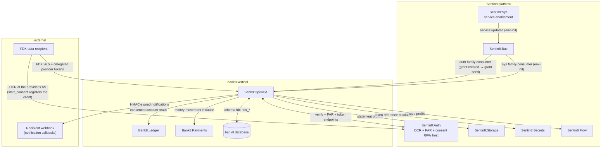
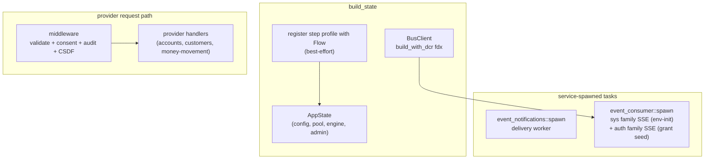
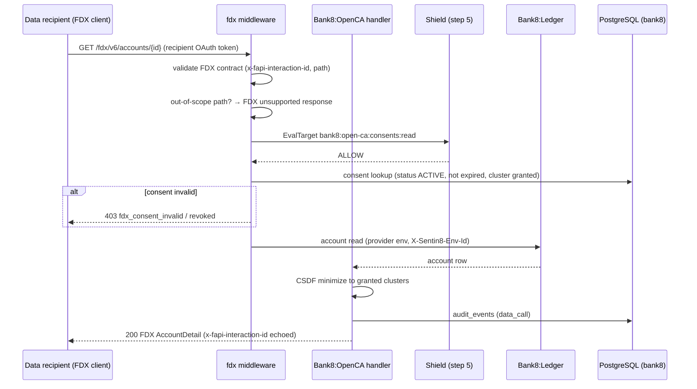
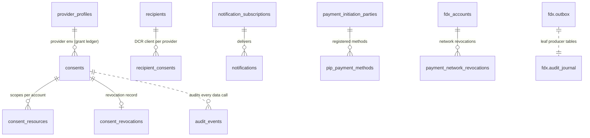
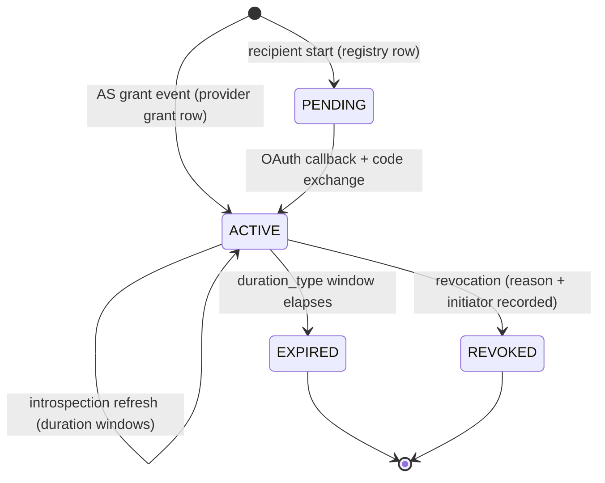
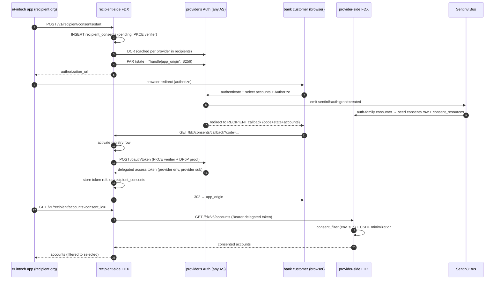
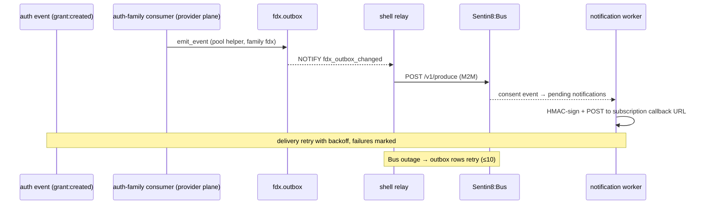
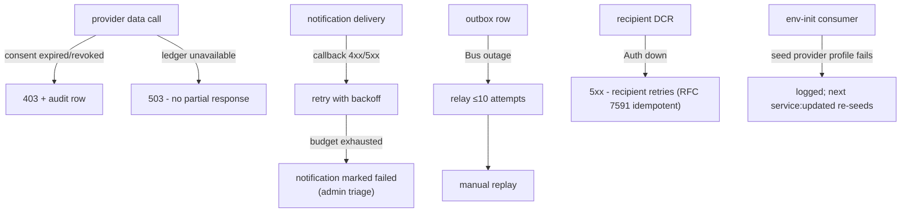
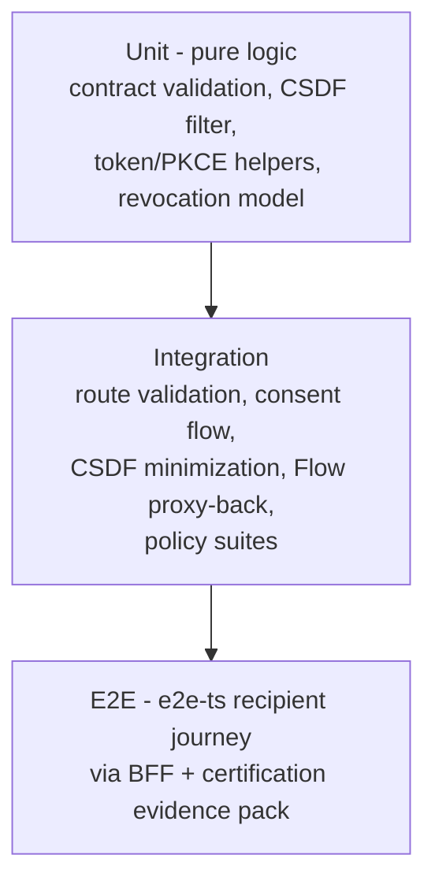

# Bank8:OpenCA - Detailed Design Document

## 1. Scope & Context
**The inter-institution consent model.** An FDX consent is open
banking between two INDEPENDENT organizations: the provider (a
data holder such as iBank) and the recipient (a fintech such as
iFinTech). Either institution may run Sentin8 or any other
technology - nothing in the consent contract may assume both
sides share a platform, a database, or a tenant model. The only
contract between the two institutions is standards-based OAuth at
the provider's authorization server (Sentin8:Auth when the provider
runs Sentin8, or any third-party AS): DCR (RFC 7591) for client
registration, PAR (RFC 9126) + PKCE (RFC 7636) + DPoP (RFC 9449)
for the ceremony, the provider's public FDX v6.5 data API for reads,
and delegated bearer tokens for authorization. In the e2e the two
parties happen to be two Sentin8 orgs+envs - that is an example
deployment, not a coupling the design may rely on.

**Two ledgers - each institution keeps its own records (FDXENV-1,
decided 2026-10-14).** There is NO cross-tenant SQL between the two
sides. Each institution's software writes only its own tables in
its own environment:

- **The provider's grant ledger** - `fdx.consents` (+
  `consent_resources`) in the PROVIDER tenant. The data holder
carries the statutory open-banking obligations (grant capture,
per-request scope enforcement via CSDF minimization §6.1,
revocation, audit), so the grant row lives where the enforcement
plane reads it. The row is **seeded by the provider's own software
from the authorization-server event**: Sentin8:Auth emits
`sentin8:auth:grant:created` at code issuance and the provider-side
fdx instance's `auth`-family consumer creates the grant row
(consent handle from the OAuth `state`, provider-customer subject
from the event's `user_id`, the customer's selected accounts as
`consent_resources`). A provider whose AS is a third-party seeds
its grant table through its own AS integration - in both cases the
RECIPIENT never writes into the provider.
- **The recipient's consent registry** - `fdx.recipient_consents`
in the RECIPIENT tenant. The fintech keeps its own bookkeeping of
its customers' consents: its own customer id, the provider,
requested scopes, selected accounts, PKCE verifier, and the
token references for the delegated provider tokens it holds as the
OAuth client. Written by the recipient-side fdx at consent start
(`pending`) and at the OAuth callback (`active`); read by the
fintech app's Connections/Accounts pages (same-env reads).

The OAuth **client belongs to the recipient**: `fdx.recipients` is
the recipient's per-provider DCR registry (client_id + DPoP key
per (recipient env, provider)), and the registered redirect_uri is
the RECIPIENT's env callback host - so the code+state come back to
the institution that must exchange them. Token custody follows
the verifier: the recipient, as the client that presented the
PKCE challenge, exchanges the code and keeps the tokens.

Rejected alternatives: a sanctioned cross-tenant read from the
recipient instance into the provider tenant (couples two
institutions through one platform's RLS - meaningless for a
recipient that does not run Sentin8); a SECURITY DEFINER callback
lookup (a permanent RLS bypass in the one table where enforcement
matters most, and it inverts the authority - the recipient's
tenant would govern what the bank may release); a dual-write of one
grant row across both tenants (two sources of truth for a
security-critical grant drift - revoked on one side, active on
the other).
Bank8:OpenCA owns: the FDX schema `fdx` (schema-per-service - the
provider grant ledger, the recipient registry, and the rest of the
15 domain tables + the `fdx.outbox` / `fdx.audit_journal`
producer tables in the same schema), the FDX v6.5
**data-provider** API
(`/fdx/v6/*`, 35 routes), the **recipient** surfaces (`/v1/recipient/*`,
13 routes), the hosted consent RFW endpoints (`/v1/auth/consent/*`,
4 routes), the FDX notification delivery worker, and the
`bank8:open-ca:*` event family (16 event types). It is the data-access
consent authority for the vertical.

It does NOT own: account/transaction data (Bank8:Ledger - read via its
public API), statements at rest (Sentin8:Storage - download via signed
URLs), recipient identities (the recipient is an OAuth client at the
provider's AS - registered there, never proxied through this
service), money movement execution (Bank8:Payments - FDX surfaces the
reads and initiation), or workflow execution (Sentin8:Flow - the
`/v1/internal/steps/execute` profile for FDX step types).

## 2. Runtime Architecture

Shell-owned boot plus two service-spawned consumers and one Flow
registration:

**Request lifecycle - provider account read (the core family)**:

## 3. Data Model

15 domain tables in the service's own schema `fdx`
(schema-per-service) + the producer tables `fdx.outbox` /
`fdx.audit_journal` in the same schema. All env-scoped, FORCE-RLS.

The grant ledger and the recipient registry live in DIFFERENT
tenants by design (§1) - the ER shows the logical shape of each
side's own tables, not a join across tenants. No SQL ever spans the
provider and recipient environments.

Complete table inventory:

| Table | Purpose | Visibility |
|---|---|---|
| `consents` | Provider GRANT ledger: consent handle, provider-customer id (the token `sub`), recipient client_id, scopes, data clusters, `duration_type`/window - seeded from `sentin8:auth:grant:created` | provider env |
| `consent_resources` | Per-account grant rows (CSDF input) - the customer's selected accounts from the AS ceremony | provider env |
| `consent_revocations` | Revocation records (reason, initiator, other_reason, timestamp) | provider env |
| `recipient_consents` | RECIPIENT registry: the fintech's customer id, provider, scopes, selected accounts, PKCE `code_verifier`, delegated-token secret references | recipient env |
| `recipients` | The recipient's per-provider DCR client registry: client_id + DPoP key reference per (recipient env, provider) | recipient env |
| `provider_profiles` | The recipient-side directory of providers (issuer URL, FDX version, capabilities) - the cross-env CATALOG, auto-registered at env-init; readable by recipient apps listing providers | env-scoped catalog |
| `audit_events` | Every provider data call (`data_call*` actions) | provider env |
| `notification_subscriptions` | Callback URL + HMAC secret reference, event filters | provider env |
| `notifications` | Pending/delivered/failed notification queue | provider env |
| `payment_initiation_parties` | PIP registration surface | env |
| `pip_payment_methods` | PIP registered payment methods | env |
| `payment_network_revocations` | Payment-network consent revocations | env |
| `fdx_accounts` (via accounts) | Account payment-network bindings | env |
| `fdx.outbox` / `fdx.audit_journal` | Producer tables (shell relay/pusher) | FORCE |

**Consent lifecycle** (BOTH ledgers follow the same state shape -
the provider's grant ledger transitions are driven by the AS event
+ data-plane revocation; the recipient's registry transitions by its
own start/callback/revoke surfaces):

**Consent flow (the full ceremony across the two institutions)**:

## 4. API Surface

**Provider API** (`/fdx/v6/*`, recipient OAuth tokens, Shield-gated +
consent-checked in middleware):

| Family | Endpoints | Gate |
|---|---|---|
| Accounts | `GET /fdx/v6/accounts`, `…/{id}`, `…/{id}/transactions`, `…/{id}/statements`, `…/{id}/statements/{statementId}` (302 → Storage signed URL), `…/{id}/payment-networks`, `…/{id}/payment-networks/{paymentNetworkId}` + `/revocation` | `bank8:open-ca:consents:read` |
| Customers | `GET /fdx/v6/customers`, `/customers/current` | consents:read |
| Consents | `GET /fdx/v6/consents/{id}`, `POST …/{id}/revocation`, `GET/POST …/{id}/lifecycle` | consents:read / write |
| Money movement | `POST /fdx/v6/transfers`, `GET …/transfers/{transferId}` (+ update/cancel), `POST /fdx/v6/payments`, `GET …/payments/{paymentId}`, `GET/POST /fdx/v6/payees`, `PUT /fdx/v6/payees/{payeeId}` | consents:write family |
| PIP | `POST /fdx/v6/payment-initiation-parties`, `GET …/{partyId}`, `POST …/{partyId}/payment-methods`, `DELETE …/{partyId}/payment-methods/{regId}` | consents:write |
| Recurring | `GET/POST /fdx/v6/recurring-payments`, `GET …/{recurringPaymentId}` + `/payments` | consents:read/write |
| Notifications | `GET/POST /fdx/v6/notification-subscriptions`, `GET …/{subscriptionId}`, `GET /fdx/v6/notifications` | consents:read/write |
| Discovery | `GET /fdx/v6/capability`, `…/availability`, `…/certification-metrics`, `…/operation-support` | none (discovery) |

(DCR is no longer proxied: the recipient's OAuth client is registered
at the provider's AS by the RECIPIENT-side instance at consent start
(`fdx.recipients` caches the client per provider) - the
`/fdx/v6/register` proxy family is retired.)

**Recipient surfaces** (`/v1/recipient/*`, user/app tokens - served by
the RECIPIENT-side instance against the recipient registry):
`GET /v1/recipient/providers` + `/{id}` (discovery),
`POST /v1/recipient/consents/start` (DCR-cache + PAR flow start),
`GET /v1/recipient/consents` + `/{id}` (list/detail of the
recipient's OWN registry),
`POST …/{id}/refresh` (delegated-token refresh at the provider AS),
`POST …/{id}/revoke`, `GET /v1/recipient/accounts` +
`/{id}/transactions` (consented data reads - the instance calls the
provider's PUBLIC `/fdx/v6/*` API with the delegated provider token,
never another institution's tables),
`GET /v1/recipient/notifications`, and `GET /fdx/consents/callback`
(the RECIPIENT's registered OAuth redirect target - code exchange +
registry activation happen here, in the recipient tenant).

**Hosted consent RFW** (`/v1/auth/consent/*`, served to auth-ui's
consent host; Sentin8:Auth proxies these here):
`GET /v1/auth/consent/ui` (screen definitions),
`GET /v1/auth/consent/accounts` (consent-scoped account list),
`POST /v1/auth/consent/approve`, `POST /v1/auth/consent/deny`.

**Internal**: `POST /v1/internal/steps/execute` (Flow step profile for
FDX step types - M2M-gated).

**Admin/RFW**: `/v1/admin/ui/{page}` + `/v1/admin/{resource}` - pages:
overview, provider, recipients, consents, csdf, settings +
policy-sets/policy-decisions/relations/attributes; gates
`bank8:open-ca:admin` scoped (`consents:*`, `recipient:*`, `provider:*`,
`policy:*`).

**Complete event catalog** (family `fdx`, DBX producer path):

| Event type | Trigger | Payload |
|---|---|---|
| `bank8:open-ca:consent:created` / `:updated` / `:revoked` | grant-ledger lifecycle (provider plane; `:created` from the AS grant event) | consent snapshot / `{consent_id, reason, initiator}` |
| `bank8:open-ca:recipientconsent:started` / `:refreshed` / `:revoked` | recipient registry lifecycle | `{consent_id, provider_id, scopes}` / `{consent_id}` |
| `bank8:open-ca:transfer:created` / `:cancelled` | money movement | transfer body / `{transfer_id}` |
| `bank8:open-ca:payment:created` | payment initiation | payment body |
| `bank8:open-ca:recurringpayment:created` | recurring registration | `{recurring_id}` |
| `bank8:open-ca:payee:created` | payee create | payee body |
| `bank8:open-ca:paymentinitiationparty:created` | PIP registration | party body |
| `bank8:open-ca:paymentnetwork:revoked` | network revocation | `{account_id, network_id}` |
| `bank8:open-ca:notificationsubscription:created` / `:deleted` | subscription lifecycle | `{subscription_id}` |
| `bank8:open-ca:providerprofile:updated` | env-init re-registration | profile snapshot |

## 5. Cross-Cutting Concerns

- **Auth**: delegated provider tokens (recipient OAuth flows) on
  provider routes; user/app tokens on recipient routes; the
  middleware is the single consent + contract chokepoint; Shield is
  the authorization decision. The provider plane's consent check keys
  on (caller env, token `sub`) - the grant row's customer_id IS the
  token subject, both being the provider's user id at code issuance.
- **Tenant**: the provider plane serves per provider-env
  (`X-Sentin8-Env-Id`); the recipient plane serves per recipient-env
  - each reads ONLY its own tenant's tables (§1 two-ledger model:
  no cross-tenant SQL between the two institutions). RLS scopes
  every table. Every handler that touches a tenant table follows the
  **same-transaction discipline** (sentin8 RLS helpers use
  `set_config(..., true)` = transaction-local): `pool.begin()` →
  `set_tenant_context` → statement(s) on THAT connection → commit. A
  bare `pool.acquire()` is never sufficient - the context evaporates
  at the statement's implicit commit and the next statement runs with
  `context_initialized=false`, so FORCE-RLS rejects it (`new row
  violates row-level security policy`), surfacing as 500s.
  (`consents/start` incident: PAR-registered consents uncreatable.)
- **Secrets**: delegated provider tokens + webhook HMAC secrets are
  secret-references resolved at call time (the recipient plane's
  tokens live on `recipient_consents`; the provider plane holds none).
- **Idempotency**: consent operations are idempotent on consent id;
  money-movement initiation delegates idempotency to Bank8:Payments.
- **Audit**: `audit_events` records every provider data call
  (action `data_call*`) + the journal pushed to Sys.
- **CSDF**: data minimization projects responses to the granted
  clusters before serialization.
- **Drain/TLS**: platform standard.

## 6. Failure Modes & Recovery

- **Crash mid-consent-revocation**: the revocation row + consent update
  commit atomically; the outbox event rides the same DB.
- **Callback poisoning**: failed deliveries never hot-loop - marked and
  surfaced in the admin notifications page.
- **JWKS rotation**: standard Auth verify path.
- **Env-init**: provider profile registration only (the recipient
  client + DPoP key are registered at consent START against the
  provider's AS - `ensure_recipient_client`/`ensure_recipient_dpop_key`
  in env-init and their `provider_profiles` columns are retired).

## 7. Concurrency & Performance Model

- Tasks: notification delivery worker (serial batches), sys-family SSE
  consumer, shell relay/pusher. No other loops.
- Capped pool (≤3).
- Hot path: consent lookup on every provider call (indexed on consent
  id + status; env-scoped).
- CSDF minimization is in-memory per response - no extra queries.

## 8. Invariants, Insecure-Defaults Rejected, Unsafe Rationale

- No provider route bypasses the consent middleware - the router mounts
  provider routes behind it as a sub-router layer.
- No plaintext delegated tokens in any column (secret references only).
- Out-of-scope FDX families return the standard unsupported-operation
  response, never stubbed data.
- Revoked consents are terminal - introspection can never revive one.
- Every tenant-table write runs inside the same transaction as the
  tenant-context set (§5 same-transaction discipline) - a context set on
  a bare autocommit connection is a defect, not an optimization.
- No cross-tenant SQL between the provider and recipient planes - each
  institution's instance reads and writes only its own env's tables
  (§1; a cross-tenant grant read is a design defect, not an access
  path).
- No `unsafe` code.
- Rejected defaults: trusting the recipient's scope claim without the
  consent row check; permissive CORS on provider routes.

## 9. Testing Strategy

- **Unit**: FDX contract validation, the CSDF filter, and the consent
  record model are pure-function tested.
- **Integration**: provider route validation, the recipient consent
  flow end-to-end against a scratch DB, and the Flow step contract.
- **Deliberately not tested**: the recipient's own client behavior;
  live external recipient callbacks (worker retry semantics are covered
  by unit tests on the retry predicate).

## 10. Open Questions

- ~~`recipient_dpop_key_pem` sealing~~ - **done**: the ES256 key is
  sealed at env-init (`ensure_recipient_dpop_key` stores a
  `sentin8-secrets://` reference in `recipient_dpop_key_ref`) and
  resolved through Sentin8:Secrets at token-exchange time
  (`load_dpop_key`); rotation is a reference swap.
- ~~Certification metrics~~ - **implemented** (design §10): the handler
  serves counts over `audit_events` (`data_call*`) and consent
  granted/revoked transitions, behind a short bounded cache (30 s,
  prune-on-insert). The daily rollup table + evidence admin page remain
  deferred work at scale.
- **Response caching for recipient polling** is deferred with an explicit
  trigger: a recipient exceeding FDX poll guidance whose p95
  consent+proxy latency degrades. The design when triggered: a bounded TTL
  cache keyed `(recipient_client_id, consent_id, route, account_id)`,
  invalidated by consuming this service's own `fdx` family consent events
  (direct consumer - no Func). The consent check itself (indexed single-row
  lookup) is never cached.

---

**Architecture & Design:** bank8:open-ca and its underlying concepts were designed by [Hamid Jahanzad](https://www.linkedin.com/in/hamidjahanzad/).

