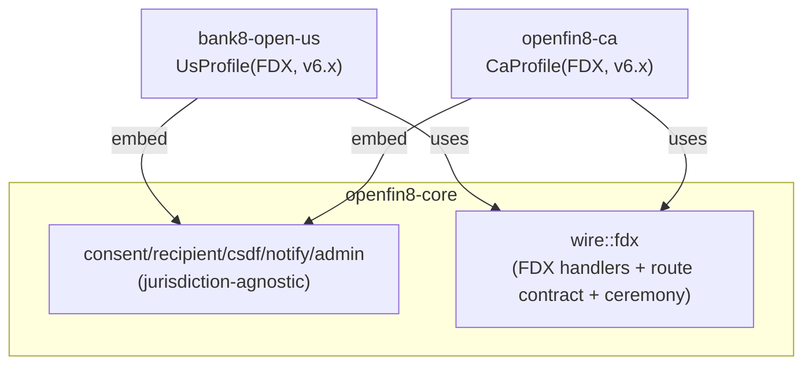

# openfin8-ca - Detailed Design Document

> Status: **PROPOSED** - the open-banking data provider for Canada
> (OBARCH-4). Canada's consumer-driven banking framework (Department
> of Finance policy statements, 2024 framework targeting 2026
> implementation) rides the **FDX API profile** - the same wire family
> as the US service. This document defines the Canadian profile as a
> thin variant of `bank8-open-us`, not a fork. Depends on:
> `openfin8-core` (OBARCH-1). Read `bank8-open-us.DESIGN.md` first -
> this document defines only the deltas.

## 1. Scope & Context

**What this service is.** The Canadian open-banking data provider
(`service_type: openfin8:ca`, binary `openfin8-ca`): the FDX
wire surface for Canadian banks - consent-checked data sharing over
`/fdx/v{major}/*` with the Canadian profile's versions, cluster
vocabulary, and regulatory framing. It embeds `openfin8-core` with
a Canadian profile descriptor; the wire handlers are the **FDX
handlers shared with `bank8-open-us`** via the core crate's FDX wire
module (the first and only place where two adapters share a wire
implementation - see §2).

**Why a separate service, not a config flag on open-us.** Three
reasons, even though the wire is identical:

1. **Independent version cadence** - Canada's FDX profile version
   may diverge from the US's (Canadian banks certify against
   Canadian profile releases on their own schedule;
   `OPENFIN8_CA_VERSION` is independent of
   `BANK8_OPEN_US_VERSION`).
2. **Independent enablement** - a bank running both markets enables
   `bank8:open-us` and `openfin8:ca` independently per
   environment through `sys.services` (the platform mechanism,
   OBARCH-1 §6); one binary with a runtime flag would couple
   upgrades and blast radius.
3. **Regulatory posture** - the Canadian consumer-driven banking
   regime will arrive with its own certification/conformance
   expectations (accreditation, directory participation, and
   customer-experience rules are all pending in legislation);
   isolating the service gives those obligations a place to land
   without touching the US surface.

**What is shared with open-us vs owned by open-ca:**

| Layer | Ownership |
|---|---|
| Core ledger/registry/CSDF/notify/admin | `openfin8-core` (shared by all) |
| FDX wire handlers, DTOs, route contract table | **core::wire::fdx** - shared module used by both US and CA adapters |
| FDX ceremony (DCR+PAR+PKCE+DPoP) | core::ceremony::fdx - shared |
| Profile descriptor, version, cluster vocabulary deltas, registration data, admin settings, spec publication policy | **per adapter** |

The FDX wire moves into core as a *wire library* (not a profile
default): both adapters construct their profile descriptors from it,
passing their jurisdiction, version, and vocabulary. This keeps the
two adapters as thin descriptors while core keeps exactly one copy
of the FDX surface - no fork risk between the two markets.



## 2. The Canadian Profile

```rust
pub struct CaProfile {
    version: String,   // OPENFIN8_CA_VERSION, default "6.5"
}

impl OpenBankingProfile for CaProfile {
    fn jurisdiction(&self) -> &'static str { "ca" }
    fn standard(&self) -> StandardDescriptor {
        StandardDescriptor {
            name: "FDX",                    // Canadian profile of FDX
            version: self.version.clone(),
            license: StandardLicense::CustomerSupplied,
            families: &["ACCOUNTS", "TRANSACTIONS", "STATEMENTS",
                        "CUSTOMERS", "PAYMENTS", "TRANSFERS", "PIP"],
        }
    }
    fn provider_prefix(&self) -> String {
        format!("/fdx/v{}", major_of(&self.version))
    }
    fn data_clusters(&self) -> &'static [DataClusterDef] {
        &FDX_CLUSTERS          // identical vocabulary at v6.x
    }
    fn scope_to_clusters(&self, scope: &str) -> Vec<DataCluster> {
        fdx_scope_map(scope)
    }
    fn route_contract(&self) -> &'static [RouteDef] { &FDX_ROUTES }
    fn envelope(&self) -> EnvelopeStyle { EnvelopeStyle::Flat }
    fn spec_publication(&self) -> SpecPublicationPolicy {
        SpecPublicationPolicy::CustomerSupplied   // FDX license covers CA too
    }
}
```

The differences from `UsProfile` are exactly: jurisdiction key,
version independence, subdomain/registration identity, and whatever
the Canadian profile specifies when the federal framework's
technical annex lands. Everything else is inherited from the shared
`wire::fdx`.

## 3. Canadian-Specific Watch Items (design-time hooks, not implementations)

The federal framework is not yet legislated in final form; this
service keeps explicit, isolated extension points rather than
pre-building speculative machinery:

1. **Directory/accreditation hook** - Canada's model is expected to
   include a central directory and accreditation regime (as the UK
   and Brazil have). The `ConsentCeremony::ensure_client` path and
   the `recipients` registry leave room for a
   `registration_authority` config (today: DCR-direct at the
   provider's AS, unchanged).
2. **Language obligations** - the consent RFW screens
   (`ConsentScreens` trait) accept locale parameters; the Canadian
   profile will require bilingual (EN/FR) consent wording. The
   `scope_labels` hook takes a locale argument at the trait level
   from day one so the CA adapter can supply both.
3. **Payment-network scope** - Canadian payment rails (Interac,
   Lynx) surface differently from US ACH/card networks; the
   `payment_networks` family's network identifiers are profile
   data. No schema change - the `payment_network_revocations` and
   PIP tables store network ids as text today.

Each item is a marker in this document, deliberately not
implemented ahead of the published technical requirements.

## 4. API Surface

Identical families to `bank8-open-us` §4 (the shared FDX wire):
accounts + statements + payment-networks, customers, consents,
money movement, PIP, recurring, notification subscriptions, and
discovery - mounted at the CA-configured version prefix. Admin pages:
core pages + the CA settings page (version selector +
locale toggles when §3.2 lands).

## 5. Data Model

Schema `openfin8_ca` - the core tables (OBARCH-1 §3), freshly migrated
by `core::sql::migrations("openfin8_ca")`. No fdx → openfin8_ca data
migration exists unless a Canadian customer previously ran
`bank8-fdx` as their Canadian surface - in that case the same
schema-rename migration tooling built for the US rename
(`bank8-open-us` §5) applies, selected by the operator.

## 6. Registration & Configuration

- `service-registration.json`: service_type `openfin8:ca`,
  subdomain `openfin8-ca`, Shield gates `openfin8:ca:*` (the
  policy-set renames follow the US pattern).
- `catalog.json`: binary `openfin8-ca`, database env var
  `OPENFIN8_CA_DATABASE_URL`.
- Env: `OPENFIN8_CA_PORT`, `OPENFIN8_CA_DATABASE_URL`,
  `OPENFIN8_CA_BASE_URL`, `OPENFIN8_CA_VERSION`,
  `OPENFIN8_CA_STREAM_FAMILY` (default `open-ca`). Per-env
  overrides via `sys.services.config` as in OBARCH-1 §6.

## 7. Spec Publication (OBARCH-2)

Same policy as the US: `CustomerSupplied`. The FDX API License
covers the Canadian profile as published by FDX - the spec is never
committed; `specs/README.md` directs Canadian customers to obtain the
FDX API specification under the FDX API License and place it under
gitignored `specs/fdx/{version}/`. The drift guard
(`tests/openapi_publication.rs`) asserts zero `/fdx/` paths and zero
FDX-derived schema names in the published bank8-owned spec.

## 8. Failure Modes / Invariants / Testing

Inherited wholesale from OBARCH-1 §8 and `bank8-open-us` §8 - the
same invariants (consent chokepoint, terminal revocation, secret
references, tenant discipline, profile isolation). Testing: the CA
adapter reuses the shared FDX wire integration tests with the CA
profile + its own registration/admin/settings unit tests; the e2e
recipient journey gains a CA configuration variant (same wire,
different service identity) when a Canadian deployment exists to
drive it.

## 9. Open Questions

- **Canadian profile divergence** - whether Finance Canada's
  technical annex mandates a distinct API versioning scheme or
  namespace (e.g., a `/cdx/` prefix or version skew from the US) -
  tracked against the federal framework's publication; the
  `provider_prefix` hook is where it lands.
- **Shared wire vs per-market wire** - if the Canadian profile
  diverges materially from FDX (as CDX-specific extensions), the
  shared `wire::fdx` module needs a fork point; the design intent
  is to fork only at that moment, into `wire::cdx`, keeping both
  under core so the divergence is visible in one repository.

---

**Architecture & Design:** openfin8:ca and its underlying concepts were
designed by [Hamid Jahanzad](https://www.linkedin.com/in/hamidjahanzad/).
