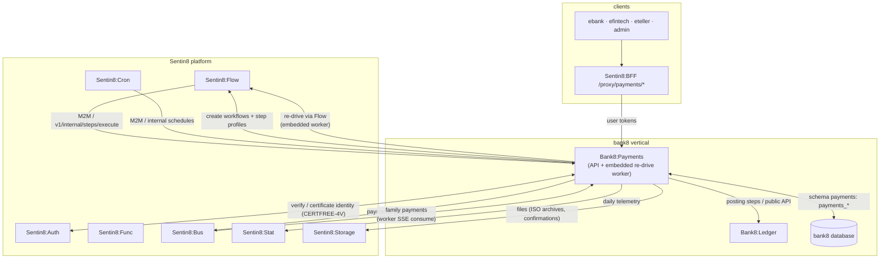
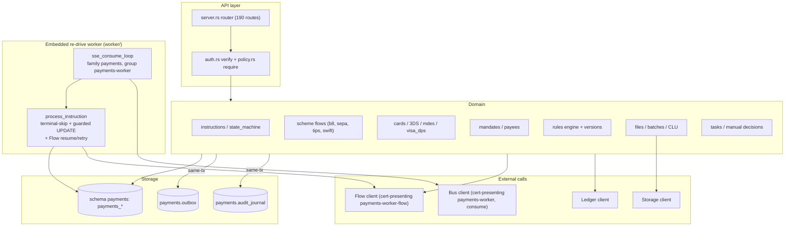
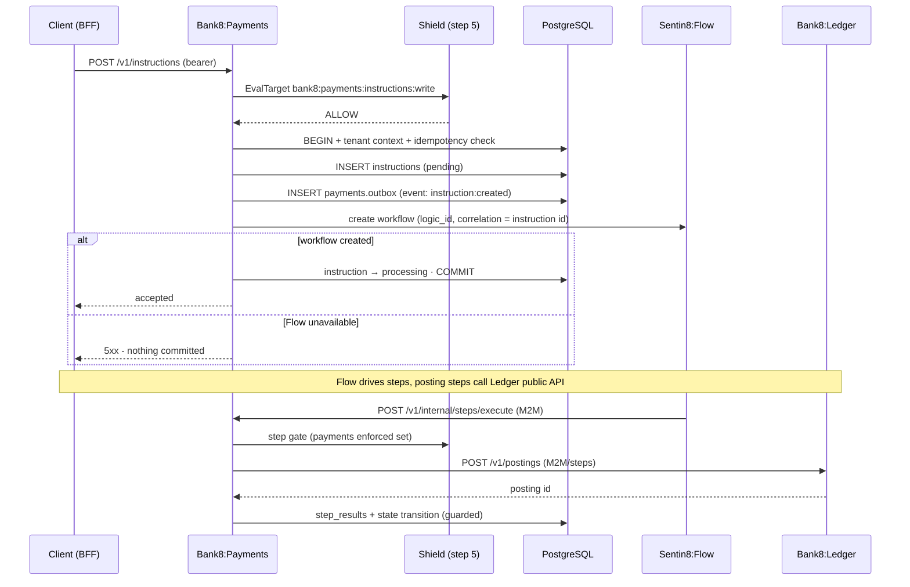
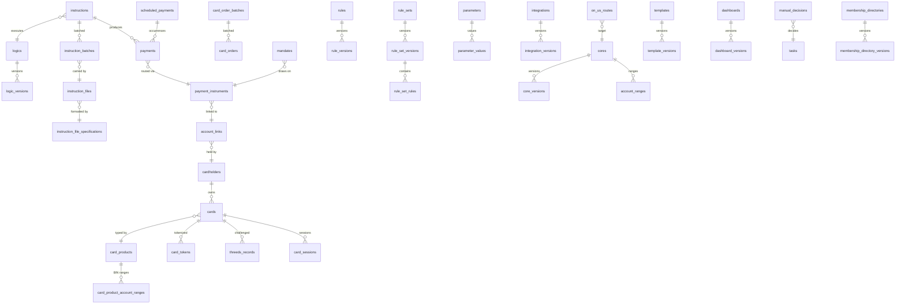
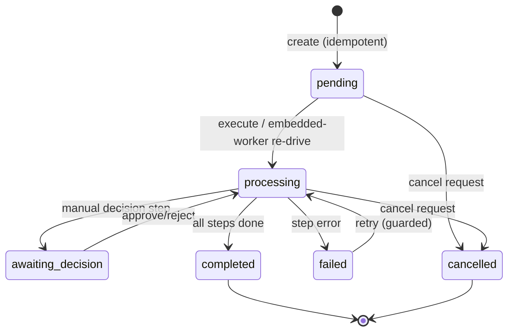
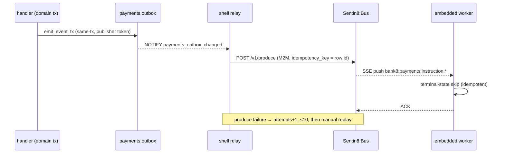
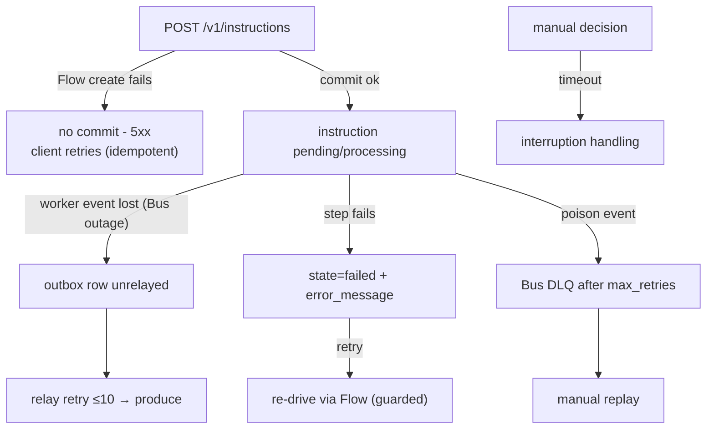
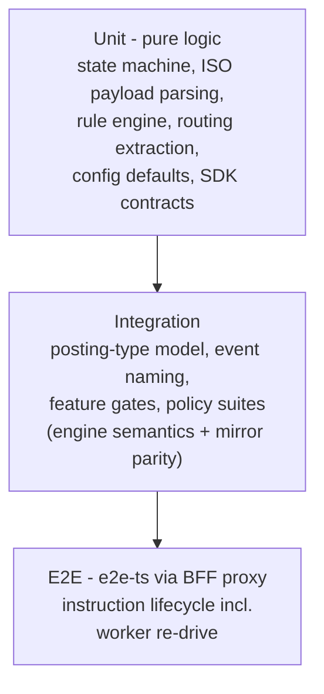

# Bank8:Payments - Detailed Design Document

## 1. Scope & Context

Bank8:Payments owns: the payments domain schema `payments`
(schema-per-service - 55 domain tables + the `payments.outbox` /
`payments.audit_journal` producer tables in the same schema), the
instruction/payment REST API (90 utoipa-declared endpoints across ~45
families), the scheme flow implementations (B8, SEPA, TIPS, SWIFT AGI
over the typed ISO 20022 catalogue), card issuing + lifecycle + 3-D
Secure + card sessions, mandates, payees, on-us routing, the rule
engine and its versioned configuration library (parameters, rules,
logics, integrations, cores, templates, dashboards, config packs,
membership directories), file processing (ISO file specs, batches),
manual decisions/tasks, sandbox simulators, and the
`bank8:payments:*` event family (25 resource types). The **async
re-drive loop is embedded** (`worker` module - an in-process Bus SSE
consumer that turns `bank8:payments:instruction:*` events into Flow
workflow resume/retry; the former standalone `payments-worker` binary,
merged following the platform's stat-worker precedent).

It does NOT own: workflow execution (Sentin8:Flow), scheduling
(Sentin8:Cron), tenant hooks (Sentin8:Func), or balances/postings
(Bank8:Ledger - called via its public API).

## 2. Runtime Architecture

Shell-owned boot (pool, Shield engine, outbox relay on
`payments_outbox_changed`, journal pusher via `payments-audit`) plus
**one service-spawned task**: the embedded re-drive worker (`worker::spawn`
- a Bus SSE consumer on the `payments` family that turns
`bank8:payments:instruction:*` events into Flow resume/retry calls).

**Request lifecycle - instruction creation (async execution family)**:

**Sync schemes (B8 on-us, SEPA instant)** follow the same pipeline with
inline step execution and no Flow round-trip.

## 3. Data Model

55 domain tables in the service's own schema `payments` (all
env-scoped, FORCE-RLS via `payments.enable_rls()`), plus the
producer tables `payments.outbox` / `payments.audit_journal` in the
same schema. Complete inventory by family:

| Family | Tables |
|---|---|
| Instructions | `instructions` (state machine, idempotency_key, input/output JSONB, step_results), `instruction_batches`, `instruction_files`, `instruction_file_specifications` + `_versions` |
| Payments | `payments` (scheme result records) |
| Logics | `logics`, `logic_versions` (WASM migration path) |
| Routing | `payment_instruments`, `account_links`, `rule_instruments`, `on_us_routes` |
| Cards | `cardholders` (holder-scoped), `cards` (LVT/ATC accumulators), `card_products`, `card_product_account_ranges`, `card_tokens`, `card_sessions`, `card_orders`, `card_order_batches`, `threeds_records`, `sandbox_simulations` |
| Mandates | `mandates` (amount_limit), `payees` |
| Rules | `rules`, `rule_versions`, `rule_sets`, `rule_set_versions`, `rule_set_rules` |
| Parameters | `parameters`, `parameter_values` |
| Integrations | `integrations`, `integration_versions`, `initiation_apps` |
| Cores | `cores`, `core_versions`, `account_ranges` |
| Config library | `templates`, `template_versions`, `template_presets`, `dashboards`, `dashboard_versions`, `payments_config_packs` |
| Directories | `membership_directories`, `membership_directory_versions` |
| Time | `business_day_definitions`, `calendars`, `scheduled_payments` |
| Workflow | `manual_decisions`, `tasks` |
| Files | `files` (ISO archives, confirmations - payload in Storage) |
| Audit | `audit_events` (OCSF-shaped) |
| Producer | `payments.outbox`, `payments.audit_journal` (same schema, FORCE-RLS) |

Core relationships:

**Instruction state machine** (mirrored by the worker's predicate):

## 4. API Surface

All 90 utoipa-declared endpoints by family with gates (Shield step-5
targets; `security()` annotations declare the scope per endpoint):

| Family | Endpoints | Gate |
|---|---|---|
| Instructions | `GET/POST /v1/instructions`, `POST /v1/instructions/initiate`, `GET …/{id}`, `POST …/{id}/process|retry|cancel|repair`, `POST /v1/instructions/bulk-retry`, `GET /v1/payment-statuses` | `bank8:payments:instructions:read` / `:write` |
| Payments | `GET /v1/payments`, `GET …/{id}` | `bank8:payments:payments:read` |
| Logics | `GET/POST /v1/logics`, `GET …/{id}`, `POST …/{id}/migrate-wasm` | `bank8:payments:logics:read` / `:write` |
| Routing | `/v1/payment-instruments`, `/v1/account-links` (CRUD), `/v1/on-us/routing` | `bank8:payments:cards:*` / instruments |
| Rules engine | `GET/POST /v1/rules`, `POST …/{id}/publish`, `POST /v1/rules/attach-to-instrument|detach-from-instrument`, `/v1/rule-versions` + `/{id}/retry`, `/v1/rule-set-versions` + `/{id}/retry`, `/v1/rule-sets` | `bank8:payments:rules:read` / `:write` |
| Parameters | `/v1/parameters`, `/v1/parameter-values` + `/{id}` | `bank8:payments:parameters:read` |
| Integrations | `/v1/integrations` + `/{id}`, `/v1/integration-versions` + `/{id}/retry`, `/v1/integrations/callback/{token}`, `/v1/integrations/payment-initiation-apps` | `bank8:payments:integrations:read` / `:write` |
| Cores | `/v1/cores` + `/{id}`, `/v1/cores/{id}/balance-endpoint`, `/v1/core-versions`, account-ranges | `bank8:payments:cores:read` / `:write` |
| Cards | `GET/POST /v1/cards`, `GET /v1/cards/{id}`, `…/profile`, `/v1/cards/cardholders/{id}` + `/cards`, `/v1/cards/products/{id}` + `/account-ranges|add-account-ranges|remove-account-ranges`, `/v1/cards/issuance/issue|{id}/replace|get-details|get-pin|update-pin|reset-lvt|reset-pin-attempts`, `/v1/cards/sessions/initiate`, `/v1/cards/card-tokens/{id}`, `/v1/cards/3ds-records/{id}`, `/v1/cards/card-orders`, `/v1/cards/card-order-batches` | `bank8:payments:cards:read` / `:write`, `bank8:payments:issuance:read` / `:write`, `bank8:payments:cardholders:write` |
| Mandates | `GET/POST /v1/mandates` + `/{id}` | `bank8:payments:mandates:read` / `:write` |
| Payees | `/v1/payees`, `/v1/payees/{id}`, `/v1/payees/search` | mandates-family |
| Files | `GET/POST /v1/files`, `GET …/{id}`, `POST …/{id}/submit`, `/v1/instruction-files`, `/v1beta/instruction-files/initiate` | `bank8:payments:files:read` / `:write` |
| File specs | `/v1/instruction-file-specifications`, `/v1beta/instruction-file-specification-versions` + `/validate` | files-family |
| Tasks/decisions | `GET /v1/tasks` + `/{id}`, `POST …/{id}/claim|approve|reject`, `GET/POST /v1/manual-decisions` + `/{id}`, `POST …/{id}/submit` | decisions-family |
| Config library | `/v1/templates` + `/{id}/versions|publish`, `/v1/dashboards` + `/{id}/versions`, `/v1/config-packs`, `/v1/app/template-versions|template-presets|dashboard-versions` + `/validate`, `/v1/business-day-definitions`, `/v1/calendars`, `/v1/membership-directory-versions`, `/v1/membership-directory-records/search`, `/v1/records/search` | templates/dashboards/parameters scopes |
| Recurring | `/v1beta/scheduled-payments` + `/{id}` + `/fast-forward` | mandates-family |
| Sandbox | `/v1/sandbox/cards|credit-transfers|fedwire|swift-agi/simulate`, `/v1/sandbox/instructions/{id}/resume`, `/v1/sandbox/scheduled-payments/{id}/fast-forward` | sandbox surface |
| Self-describing | `GET /v1/allowed-endpoints`, `/v1/roles`, `/v1/users`, `/v1/audit`, `/v1/metrics`, `/v1/openmetrics/metrics|federate` | `bank8:payments:audit:read`, `:metrics:read`, `:openmetrics:read` |
| Health | `GET /v1/health` | none |

Internal (M2M proxy-back, the Flow contract):

| Endpoint | Caller | Contract |
|---|---|---|
| `POST /v1/internal/steps/execute` | Sentin8:Flow | domain step functions (MatchPaymentInstrument, Sentin8CorePostings, scheme calls, …) - step-5-gated, env from workflow |
| `GET/PATCH /v1/internal/instructions/{id}` | Flow / embedded worker | guarded state reads/updates |
| `GET /v1/internal/{payments,payment-instruments,account-links,parameters,rules,integrations}/{id}` | Flow steps | data access for step execution |
| `POST /v1/internal/authorisations/expire` | Cron/scheme callbacks | authorisation expiry sweep |

Admin/RFW: `/v1/admin/ui/{page}` + `/v1/admin/{resource}` (policy-sets/
relations/attributes shared pages + payments data plane).

**Event families** (family `payments`, DBX producer path): the
`ResourceType` catalogue drives `bank8:payments:{resource}:{operation}`
events for all 25 resource types - `instruction`, `payment`,
`instruction_logic`, `payment_instrument`, `account_link`, `card`,
`cardholder`, `card_order`, `three_ds_record`, `core`, `core_version`,
`file`, `instruction_file`, `integration`, `integration_version`,
`manual_decision`, `membership_directory`, `parameter`, `rule`,
`rule_set`, `rule_version`, `rule_set_version`, `template`,
`template_version`, `dashboard` - each with `created`/`updated`
operations plus the specific flows (`instruction:retried`, `:cancelled`,
`:repaired`, `instruction_logic:wasmmigrated`, `cards:encrypted`).

## 5. Cross-Cutting Concerns

- **Auth**: platform pipeline; step 5 Shield gate on every handler;
  the proxy-back endpoints verify the Flow/Func M2M bearer and
  cross-check the workflow env.
- **Tenant**: token claims + RLS context per connection; explicit
  `WHERE env_id` clauses everywhere.
- **Idempotency**: instruction `(env_id, idempotency_key)` unique
  (duplicates return the original); outbox row id = produce key;
  state-machine guards make re-drive effectively-once.
- **Audit**: `audit_events` (OCSF-shaped) for domain audit +
  `payments.audit_journal` pushed to Sys by the shell pusher
  (`payments-audit` workload).
- **Feature gates**: availability (503) vs authorization (403) are
  separate - feature flags gate availability, Shield gates access.
- **Drain/TLS**: platform-standard (health gauge + in-process PQ-TLS).

## 6. Failure Modes & Recovery

- **Crash mid-transaction**: domain + outbox rows roll back together.
- **Flow outage at creation**: request fails, nothing committed.
- **Step failure**: state=failed with reason; retry re-drives via the
  embedded worker → Flow `retry_workflow`.
- **Worker task death**: messages stay pending in the consumer group;
  redelivery after process restart.

## 7. Concurrency & Performance Model

- **Background tasks**: shell owns the relay + journal pusher; the
  service spawns the embedded re-drive worker (one SSE consume loop on
  the `payments` family).
- Capped pool (≤3) shared by the API and the embedded worker - the
  worker adds no second pool (the merge removed the standalone binary's
  pool; the platform stat merge is the precedent).
- Hot paths: instruction state updates (single-row, indexed on id +
  state), routing lookups (payment instruments by
  `bank_identifier`/`instrument_identifier` indexes), rule evaluation
  (versioned rules loaded per instruction).
- LVT/ATC accumulators update via single-column guarded UPDATEs (no
  read-modify-write races).

## 8. Invariants, Insecure-Defaults Rejected, Unsafe Rationale

- Terminal instruction states are immutable; every transition is
  state-machine-guarded.
- Drafts never execute: only published rule/logic/integration versions
  are eligible for instruction routing.
- Money is never float; card session crypto uses the documented
  deterministic placeholder layer (production HSM integration is a
  deployment concern, not code).
- The API and the embedded worker share the terminal-state predicate via
  the same guarded-SQL contract (one crate now - the two can't drift).
- No `unsafe` code.
- Rejected defaults: shadow-writing ledger balances; per-handler scope
  checks (step 5 is the only gate); unauthenticated internal endpoints.

## 9. Testing Strategy

- **Unit** (425 tests): the money/path logic is pure-function tested -
  state machine transitions, ISO 20022 payload handling, rule
  evaluation, routing extraction.
- **Integration**: posting-type model, event-stream naming + publisher
  identity, the 15 feature gates, policy wiring suites.
- **Deliberately not tested**: live scheme-gateway calls (simulator
  adapters cover the paths), platform transport layers.

## 10. Open Questions

- **Production scheme certification (Visa DPS, MDES, SWIFT) is external by
  design** - closed as a code question. The adapter seams (versioned
  `integrations` published per scheme, simulator parity) are the
  certification inputs; the vertical's remaining deliverable is a
  certification runbook (register an integration version, point it at a
  scheme test bed, collect evidence) so tenants can drive it.
- ~~File processing~~ - **implemented** (design §10): `submit` marks the
  file `processing`, creates the batch shell, and triggers the per-file
  Flow debatch workflow (`logic_id: file-debatch`, `correlation_id =
  file_id`) whose step proxies back into
  `POST /v1/internal/files/debatch` to chunk the batch and mark the file
  `processed`; the step is idempotent on the terminal-file guard, so a
  workflow retry is a no-op.
- ~~`v1beta/scheduled-payments`~~ - **Cron wiring implemented** (design
  §10): `register_recurring_schedule` registers a real Cron schedule
  (`domain: payments`, `schedule_type: recurring-{instruction_id}`) whose
  fire proxies back into `POST /v1/internal/schedules/trigger` with the
  originating instruction's id; the Cron schedule id is persisted on the
  instruction for cancellation. The `v1beta` prefix stays until the
  recurring e2e spec lands (create → sandbox fast-forward → instruction +
  posting visible).

---

**Design attribution:** bank8:payments and its underlying concepts were designed by Hamid Jahanzad <Hamid@Jahanzad.com>.

