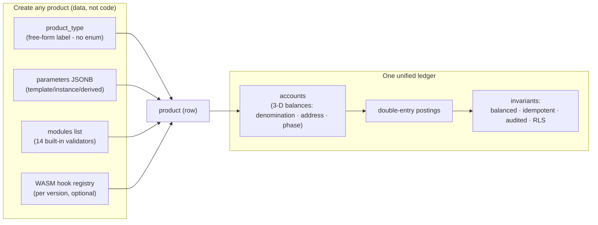

# The product factory: limitless products, one ledger

Most cores ship a fixed product catalog: a list of product types
baked into the schema, and a change request queue every time the bank
wants product number fourteen. Bank8 has **no fixed catalog and no
product enumeration at all**. A product is a row - a free-form type
label, a parameter set, and a composition of validation modules - so
*any* financial product can be created on the exact same unified
ledger: retail checking and savings, credit cards, commercial
lending, mortgages, BNPL, wallets, Shariah-compliant deposits, or
tokenized asset balances nobody has built yet.

The type space is open **by design**: `product_type` is an untyped
`TEXT` column, and unknown types are first-class - module composition
validation allows every module for a type it has not seen (a new type
gets the full library with no code change). What the shipped catalog
offers is *convenience, not a ceiling*: thirteen ready-made blueprints
(current account, savings, credit card, loan, mortgage, home-loan
redraw, line of credit, BNPL, time deposit, wallet, US
checking/savings, Shariah savings) with pre-selected default modules
and typed settings forms in the admin console - starting points a
product manager configures rather than codes, and a developer extends
or replaces entirely.

## The three layers of product creation

### 1. Parameters - products as data (zero code)

A product's rule set lives in the parameter library, not in code.
Parameters are first-class ledger objects that resolve through a
strict hierarchy - **global → product → account** - so the effective
value for any account is computed by walking the chain, never guessed:

| Layer | What it governs | How it changes |
|---|---|---|
| **Template parameters** | Product-wide rules - the standard interest rate, overdraft fee, grace period for every account on that product | One write; applies portfolio-wide instantly. `GET /v1/parameter-values:viewEffective` confirms the resolved chain before and after |
| **Instance parameters** | One customer - a custom credit limit, personalized margin rate, fee waiver | `instance_param_vals` on the account (or a flag on `account_flags`); no product change, no restart |
| **Derived parameters** | Values computed on the fly from live state - balances across addresses, tiered rewards, real-time risk pricing | Declared with `is_derived`, served via `/v1/derived-parameter-values`; computed, never stored, so they can never go stale |

Because parameters are data, launching or changing a product needs no
engineering release - and no data migration either, since resolution
walks the hierarchy at read/posting time.

### 2. Modules - compose the rule set

Products compose behaviour by listing modules from the built-in
validation library (limits, overdraft rules, sweeps, tiered rates, fee
schedules, dormancy). Each module is a pure function over a
`ModuleContext` - unit-testable without a database - running at
account creation, posting time, or on schedule. Composition is
enforced per type where business sense demands it (savings cannot
carry overdraft; loans do not accrue deposit interest), and **any
composition the bank invents for a new type is valid**: unknown types
allow the full library, so a brand-new product class composes from
day one.

### 3. WASM hooks - invent behavior that has never existed

When no module expresses the rule, tenant-authored behavior compiles
to WASM (Rust and TypeScript first-class; any WASM producer works)
and runs in **Sentin8:Func**, the platform's isolated edge-function
sandbox, wired to typed hooks - `pre_posting`, `post_posting`,
`scheduled_event`, activation/deactivation. This is how the factory
stays limitless at the deepest layer: the bank writes a *new* product
behavior, not a change request into the core. A hook moves money only
by re-entering the posting pipeline through the certificate-bound
proxy-back endpoint - unbalanced batches still 422, idempotency keys
still dedupe - and a buggy module dies inside its sandbox (fuel,
memory, wall-clock caps), never as a ledger defect.
Read [Extending Bank8](/docs/extensibility) for the full sandbox
contract.

## Version everything, migrate nobody by hand

- **Versioned deployments** - every product change creates a new
  version; each version owns its own WASM registry entry (sha256
  hash, language, declared hooks, per-version parameters) with a
  `pending → active` pointer. Activation is a pointer swap - **zero
  core restarts**.
- **Account migrations** - `account_migrations` / `account_update_batches`
  transition live accounts from an old version to a new one with
  per-item retry and bulk-retry; `plan_migrations` move plan
  assignments in audited batches. Historical balances and the
  checksum-chained journal stay perfectly intact - original postings
  are never mutated, corrections land as adjustments.

## Tune how money is segmented per product

Bank8 balances are **three-dimensional** - denomination, address,
phase - rather than a single number. A product defines as many
positions as its logic needs through the address dimension:
principal, accrued interest, penalty fees, escrow, or anything the
product invents, each with end-of-day history. Dynamic posting
routing then changes how inbound payments apply to these buckets
over time (fees-first to principal-first is a parameter/hook change,
not a ledger change) - while seeded internal counterparty accounts
per denomination guarantee every booked amount nets to zero with a
real, auditable counterparty.

## Prove it before customers see it

1. **Simulate** - `POST /v1/contracts/simulate` executes a module or
   hook against synthetic account state; the run is journaled in the
   checksum-chained journal and **zero domain rows are written**. It
   is the mandatory gate in the rollout pipeline
   (upload → validate → simulate → activate).
2. **Stress-test** - Bank8:Risk runs declarative stress scenarios
   (rate spikes, liquidity shocks) over continuously measured
   exposures, and the Payments scheme simulators (cards, credit
   transfers, FedNow, SWIFT AGI) exercise production-parity paths
   without live schemes.

A product that has never existed before goes from idea to
production-parity proof with no engineering release and no customer
exposure - because it was data all along.

## Where to next

- [Bank8:Ledger](/docs/products/ledger) - the ledger's invariants and the full configuration library
- [Extending Bank8](/docs/extensibility) - the WASM edge-function sandbox contract
- [Security](/docs/security) - why extension code can never weaken a core invariant
