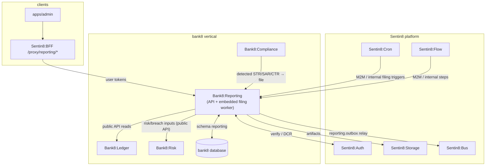
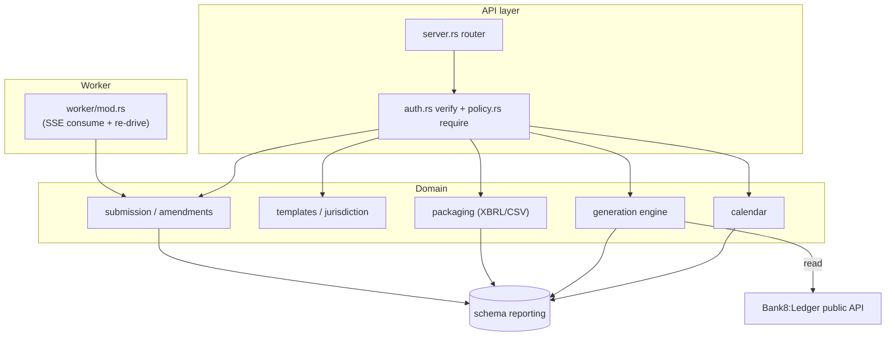
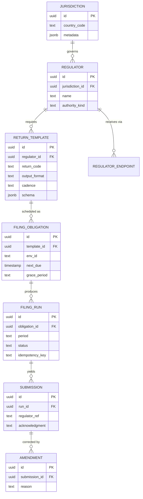
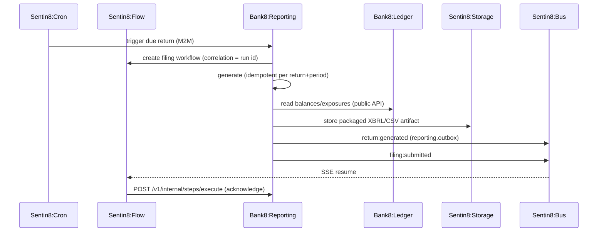
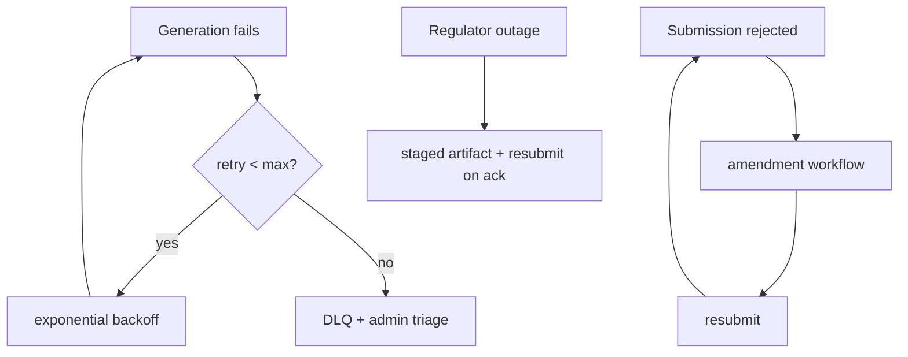

# Bank8:Reporting - Detailed Design Document

## 1. Scope & Context

Bank8:Reporting owns: the `reporting` schema (schema-per-service -
domain tables + the `reporting.outbox` / `reporting.audit_journal`
producer tables in the same schema), the filing REST API, the
jurisdiction registry resolver, the return-generation engine, the
XBRL/CSV packaging layer, the submission/amendment lifecycle, and the
`bank8:reporting:*` event family.

It does NOT own: schedule timing (Sentin8:Cron), approval/amendment
workflow execution (Sentin8:Flow), artifact byte storage
(Sentin8:Storage), balances/postings (Bank8:Ledger - read via public
API), or detection of reportable events (Bank8:Compliance / Bank8:Risk
- consumed as events and read via public APIs).

## 2. Runtime Architecture

Shell-owned boot (pool, Shield engine, outbox relay on
`reporting_outbox_changed`, journal pusher via `reporting-audit`) plus
one service-spawned task: the embedded filing worker (a Bus SSE
consumer on the `reporting` family that turns due/retry events into
Flow resume calls).

Access-decision order on every cross-service path (principles §4.7 -
**membus → bus → owner API**): (1) MemBus state refresh first -
filing-state changes publish newest-wins ephemeral notifications
(`sentin8::membus::ServiceBus`, fail-soft - never a startup
dependency) so dashboards/cockpits refresh surgically; (2) durable,
audited `bank8:reporting:*` events via the local outbox → relay →
Bus `POST /v1/produce`; (3) owner HTTP APIs (Ledger balances, Risk
exposures) only where a synchronous read-your-writes value is needed
(generation aggregation). Trigger delivery itself rides the durable
Bus tier - MemBus is state refresh, not trigger transport.

## 3. Data Model

Ownership/visibility: every table is env-scoped and RLS-enforced
(`FORCE ROW LEVEL SECURITY`, `env_id` match); `JURISDICTION` /
`REGULATOR` / `RETURN_TEMPLATE` are platform-scoped (registry data
registered via `vertical enroll`, not tenant-authored). Regulator
endpoints store credential references only - never plaintext secrets.

## 4. API Surface

| Audience | Routes | Auth gate | Events emitted |
|---|---|---|---|
| Public | `GET /v1/obligations`, `GET /v1/runs`, `GET /v1/runs/{id}`, `POST /v1/runs/{id}/regenerate`, `GET /v1/submissions` | `bank8:reporting:{obligations,runs,submissions}:{read,write}` via Shield | `bank8:reporting:return:{created,updated}` |
| Internal | `POST /v1/internal/steps/execute` (Flow proxy-back: generate/package/submit/acknowledge guarded transitions), `POST /v1/internal/calendar/schedules/run` (Cron proxy-back due-check - env from the fire envelope; the `sentin8:cron` workload is granted `runs:write` in this service's registration) | Shield + M2M | `bank8:reporting:return:created` |
| Admin/RFW | `GET /v1/admin/ui/{page}`, `GET /v1/admin/overview` | `bank8:reporting:admin` | - |

**Filing chain**: the due-check marks due obligations and plants draft
runs (idempotent per (obligation, period)); the Flow steps advance the
run through the guarded state machine (`draft → generated → packaged →
submitted → acknowledged/rejected`) - every transition is a guarded
UPDATE, so at-least-once steps converge (effectively-once). The AML
filing path rides the same machinery: a consumed
`bank8:compliance:suspicious:detected` event creates exactly one filing
run keyed `aml:{case}:{kind}` (obligation NULL - event-driven, not
calendar-driven). Corrections are amendments, never regressions.

## 5. Cross-Cutting Concerns

- **Auth**: every route verifies a Sentin8:Auth-issued token (issuer/
  signature/expiry/audience/token type) and gates via Shield against
  live-resolved roles; the JWT `scope` is a pre-filter, never the
  decision.
- **Identity - no token envs.** Every outbound call (Bus, Flow, Storage,
  peer public-API reads) presents the service's own workload certificate
  at the call site (CERTFREE-4V - the TLS handshake is the identity;
  single identity plane, principles §4.1); config carries URLs only. A
  missing transport fails the call closed - there is no static-token
  fallback anywhere.
- **Event emission (membus → bus → API)**: mutations publish the MemBus
  state refresh first (fail-soft), then append the durable outbox row
  (same transaction where one is open) - the relay owns Bus delivery.
  Owner APIs are read-only, sync-only; no cross-service table access
  ever.
- **Tenant + RLS**: `set_tenant_context` awaited on the SAME connection
  as the data query (transaction-local `set_config(..., true)`); every
  handler also carries an explicit `WHERE env_id = $N`.
- **Idempotency**: generation and submission are idempotent per
  (return, period) - re-firing the calendar never double-submits.
- **Audit**: every mutation writes `reporting.audit_journal` in the same
  transaction and pushes to Sys `POST /v1/audit`.
- **TLS**: PQ-TLS via the `sentin8-tls` library; hostname→instance
  resolution via the platform Sys resolver.

## 6. Failure Modes & Recovery

## 7. Concurrency & Performance Model

Pool capped at 3 connections (`sentin8_config::pg_pool::connect`). The
generation engine is CPU-light (aggregation queries are pushed down to
PostgreSQL); XBRL serialization is bounded by the return size, with the
artifact streamed to Storage rather than held in memory. The embedded
worker consumes the `reporting` family via SSE with ACK.

## 8. Invariants

- A filing run is idempotent per (return, period); no duplicate
  submissions reach a regulator.
- Terminal submission states (`submitted`, `acknowledged`, `rejected`)
  never regress; corrections are amendments, never mutations.
- Regulator credentials are reference-only; no secret column holds
  plaintext.
- Every reportable event is filed exactly once, or lands in the DLQ for
  manual replay - never silently dropped.

## 9. Testing Strategy

- **Contracts crate** (`crates/regulatory`) - round-trip serde pins on
  the jurisdiction/report-kind/limit shapes.
- **Policy suite** (`tests/policy.rs`) - the REAL seeded scope-mirror
  text: no-set → deny; no-match → deny; shadow never blocks; mirror
  permits its own grants; M2M parity; platform-admin passes; forbid
  beats permit; role-keyed tenant sets decide; cross-env isolation;
  registration parity (every handler action covered); enroll dry-run.
- **DB invariants** (`tests/db_invariants.rs`, runtime-skip without PG -
  all 5 pass against a live bank8 DB): FORCE-RLS rejects context-less
  inserts; (obligation, period) idempotency - a re-fired calendar never
  double-creates; guarded step transitions are effectively-once;
  terminal states never regress; the AML path files at-most-once per
  (case, kind).
- **E2E** - UI-only through the BFF (E2E-REG-1, blocked on the platform's
  WKR-ST1). Live regulator submission is out of scope (adapter seams).

## 10. Open Questions

- XBRL taxonomy versioning per regulator (single current version vs.
  multi-version support).
- Regulator portal API contracts where no machine-readable submission
  exists (manual/portal-only filing).

---

**Architecture & Design:** bank8:reporting and its underlying concepts were designed by [Hamid Jahanzad](https://www.linkedin.com/in/hamidjahanzad/).

