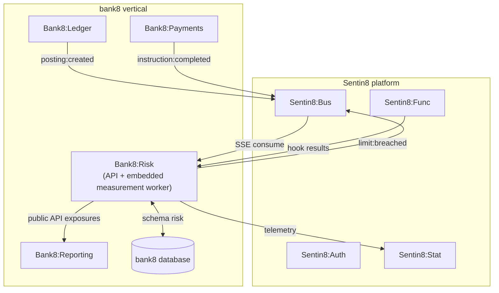
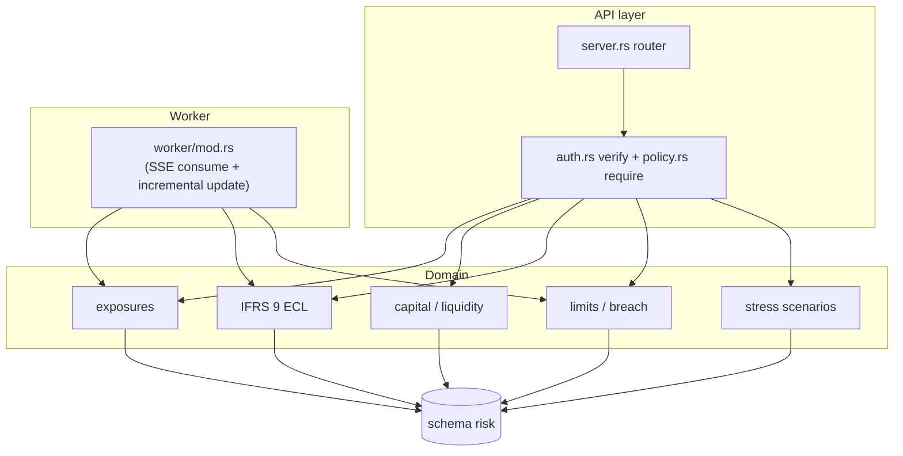
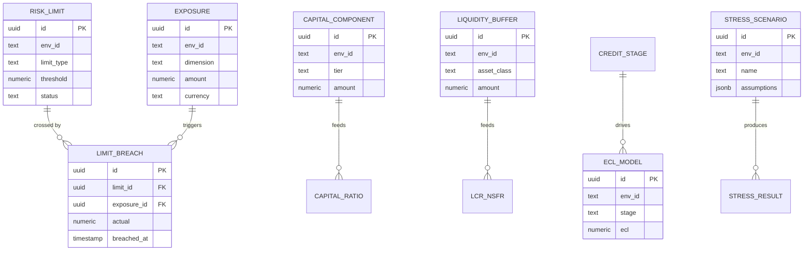
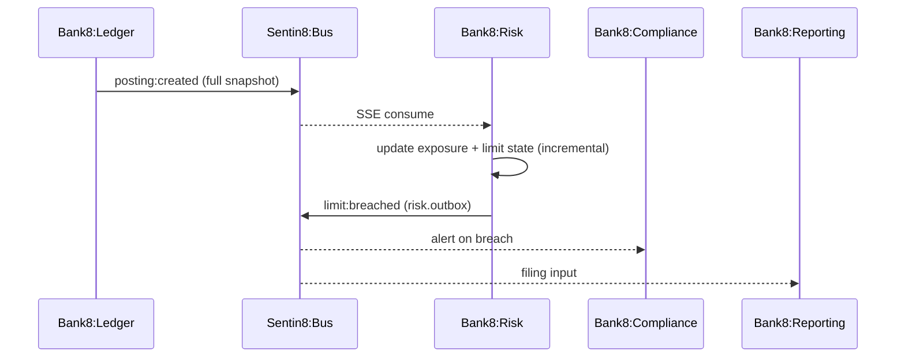
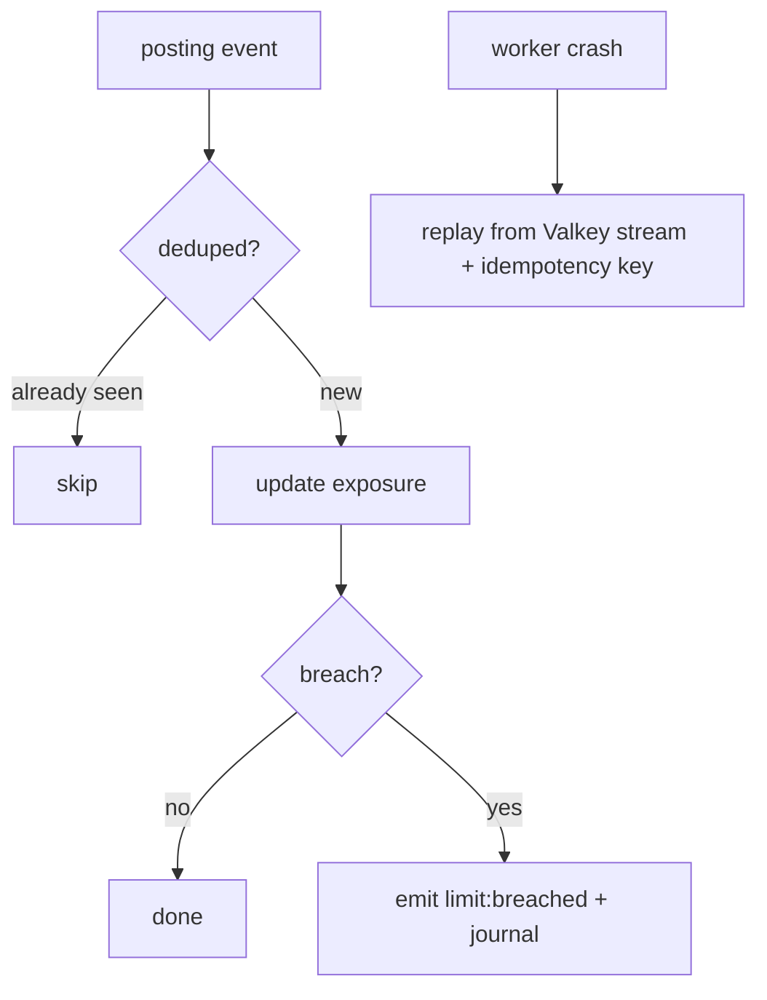

# Bank8:Risk — Detailed Design Document

## 1. Scope & Context

Bank8:Risk owns: the `risk` schema (schema-per-service — domain tables +
`risk.outbox` / `risk.audit_journal` producer tables), the risk
measurement REST API, the event-driven measurement worker, the limit
monitor, the IFRS 9 ECL engine, and the `bank8:risk:*` event family.

It does NOT own: money movement or balances (Bank8:Ledger), payment
state (Bank8:Payments), filing (Bank8:Reporting), tenant-authored hook
execution (Sentin8:Func — Risk consumes the *results*), or metric
aggregation (Sentin8:Stat).

## 2. Runtime Architecture

Shell-owned boot plus one service-spawned task: the embedded
measurement worker (a Bus SSE consumer on the `ledger`/`payments`
families that updates exposures, ECL staging, and limit state
incrementally, then emits breaches on the `risk` family).

Access-decision order (principles §4.7 — **membus → bus → owner
API**): (1) MemBus state refresh first — measured limit/exposure state
publishes newest-wins ephemeral notifications (`sentin8::membus::ServiceBus`,
fail-soft) so risk dashboards refresh surgically; (2) durable, audited
`bank8:risk:limit:breached` / `stress:completed` events via the local
outbox → relay → Bus `POST /v1/produce` — trigger delivery to
Compliance/Reporting rides this tier; (3) owner HTTP APIs only for
on-demand full recomputes (filing inputs, stress runs) that need a
synchronous aggregate. The measurement inputs themselves are Bus
events (`posting:created`, `instruction:completed`) carrying the full
domain snapshot — never cross-service table reads.

## 3. Data Model

All tables env-scoped + RLS-enforced (`FORCE ROW LEVEL SECURITY`,
`env_id` match); explicit `WHERE env_id = $N` in every handler.

## 4. API Surface

| Audience | Routes | Auth gate | Events emitted |
|---|---|---|---|
| Public | `GET /v1/exposures`, `GET /v1/limits`, `GET /v1/limits/{id}`, `POST /v1/limits` (upsert — jurisdiction floors land here as registry data), `POST /v1/stress/scenarios` (declarative authoring), `POST /v1/stress/run` | `bank8:risk:{exposures,limits,stress}:{read,write}` via Shield | `bank8:risk:limit:{breached,upserted}`, `bank8:risk:stress:{scenario:upserted,completed}` |
| Admin/RFW | `GET /v1/admin/ui/{page}`, `GET /v1/admin/overview` | `bank8:risk:admin` | — |

Scenario authoring is declarative data (assumption JSONB, idempotent per
(env, name)) — a Func-authored hook cannot be audited as a filing input
(DESIGN.md §10 resolved). A stress run is an on-demand full recompute,
idempotent per (scenario, snapshot ref).

## 5. Cross-Cutting Concerns

- **Auth**: Sentin8:Auth-issued tokens verified; Shield against live
  roles; `scope` is a pre-filter, never the decision.
- **Identity — no token envs.** The worker's certificate-presenting Bus
  client is the single outbound identity (CERTFREE-4V — single identity
  plane, principles §4.1); config carries URLs only. A failed certificate
  mint fails the consume closed — there is no static-token fallback
  anywhere.
- **Event emission (membus → bus → API)**: every measurement change
  publishes the MemBus state refresh first (fail-soft), then the durable
  outbox row; the breach/stress events trigger downstream work via Bus.
  No cross-service table access ever — inputs are event payloads.
- **Tenant + RLS**: `set_tenant_context` awaited on the same connection
  as the query; explicit `WHERE env_id = $N`.
- **Idempotency**: incremental updates are idempotent per
  (event idempotency_key); re-delivery never double-counts exposure.
- **Audit**: `risk.audit_journal` in the same transaction + Sys audit
  push.
- **TLS**: PQ-TLS via `sentin8-tls`.

## 6. Failure Modes & Recovery

## 7. Concurrency & Performance Model

Pool capped at 3. Measurement is incremental (single-row exposure
updates keyed by dimension), so the hot path is a bounded UPSERT, not a
full recompute; full recomputes run only on demand (stress tests,
filing inputs). Backpressure via Valkey consumer group ACK.

## 8. Invariants

- Exposure updates are idempotent per event idempotency key — no
  double-counting.
- A limit breach is emitted at most once per (limit, direction)
  transition.
- Risk never writes ledger or payments tables; all inputs are events or
  public API reads.

## 9. Testing Strategy

- **Contracts crate** — shared jurisdiction/limit shapes.
- **Policy suite** (`tests/policy.rs`) — the real seeded scope-mirror
  text with the handler-action parity matrix (11 tests).
- **DB invariants** (`tests/db_invariants.rs`, all 5 pass against a live
  bank8 DB): FORCE-RLS rejection; exposure UPSERT convergence (one row
  per (env, dimension, currency)); at-most-once breach transition per
  (limit); stress-run idempotency per (scenario, snapshot);
  no-cross-schema-dependence (no risk view references
  ledger/payments).
- **E2E** — UI-only through the BFF (E2E-REG-1). No live-regulator
  stress certification.

## 10. Open Questions

- Stress-scenario definition language (declarative vs. Func-authored).
- Cross-currency netting conventions for exposure aggregation.

---

**Design attribution:** bank8:risk and its underlying concepts were designed by Hamid Jahanzad <Hamid@Jahanzad.com>.

